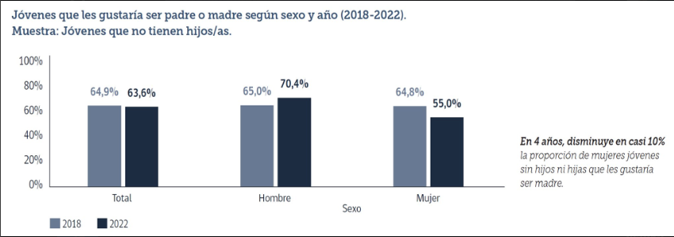
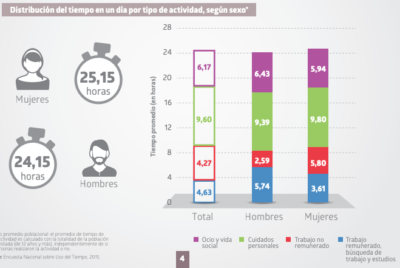
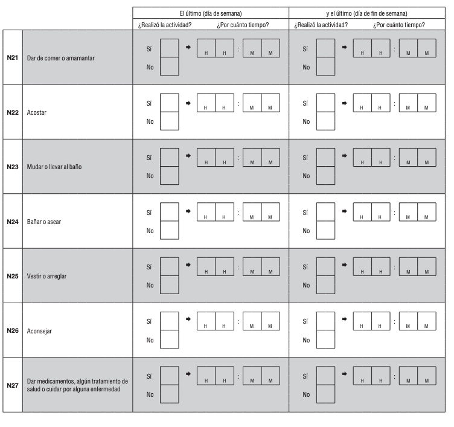
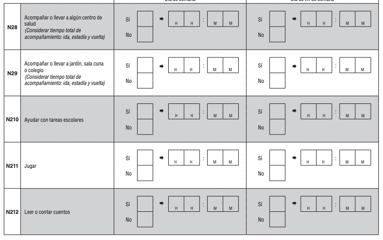
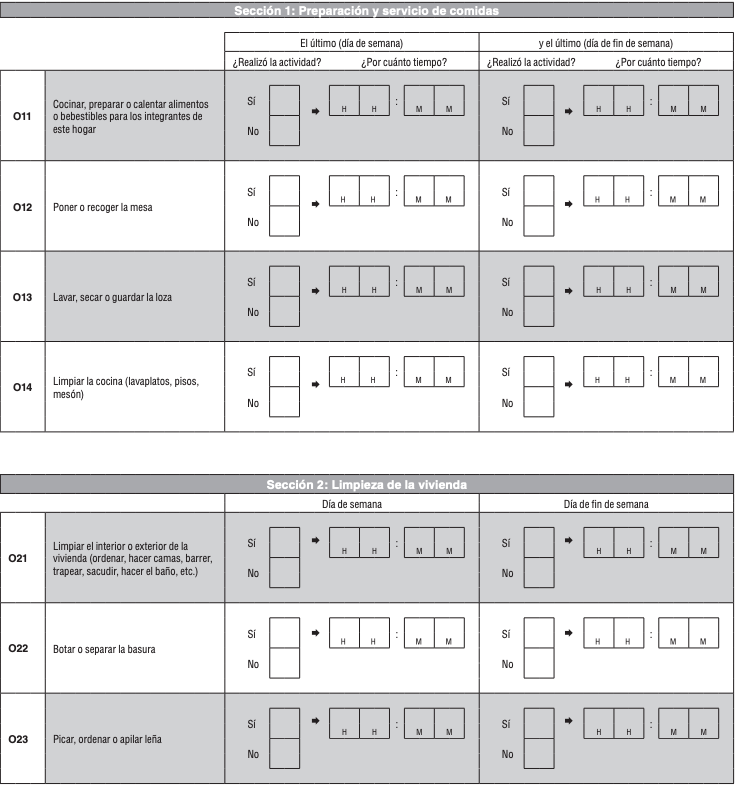
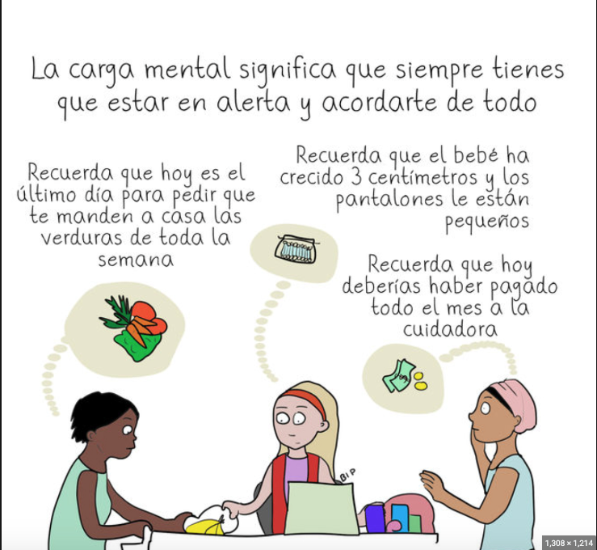
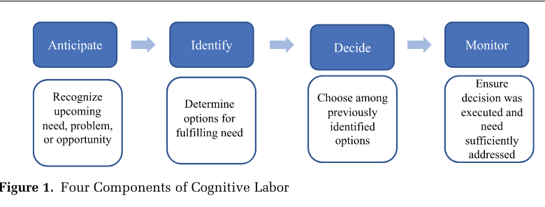
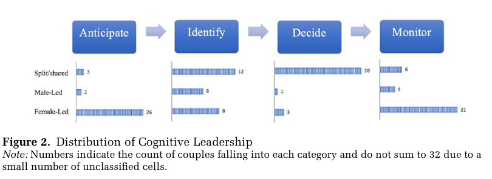

---

# Familia y Ma/Paternidades {background-image="C10_01.jpg" background-size="cover" background-opacity="0.35" style="color:white;"}

::: {style="color:#d4b8f5; font-size:1.1em; margin-top:0.5em;"}
SOL191 · Clase 10: Familia y Ma/Paternidades
:::

---

## Objetivos de hoy

::: {style="font-size:0.88em; line-height:1.8;"}
1. Describir la desigualdad de género en la familia en Chile: quién sostiene, quién cuida y quién cuenta con el tiempo.
2. Comparar tres lentes teóricos para explicar cómo se reproduce: segunda jornada, maternidad intensiva y carga cognitiva.
3. Analizar cómo el mercado laboral y las políticas moldean las decisiones de ma/paternidad (Bass, Berniell et al.).
4. Aplicar el sistema multinivel a la parentalidad gay en Chile.
:::

---

## Familia

::: {style="font-size:0.88em;"}
- [Amor y cuidado]{.hl}, pero también diferencia y desigualdad.
- Desafíos con la incorporación de la mujer al mundo laboral: falta de tiempo para realizar todas las tareas del hogar y tener un empleo remunerado.
- [Ideología de maternidad intensiva]{.hl}: la crianza debe tomar mucho tiempo, energía y recursos materiales, debe ser la prioridad sobre otros intereses, y debe ser realizada por las madres.
:::

---

## Familia en Chile: mujeres sostenedoras de hogar

::: {style="font-size:0.82em;"}
::: {.cuadro-datos}
En 2023-2024, el **43,8%** de las mujeres ocupadas es proveedora principal del hogar, lo que implica un alza de 14,4 puntos porcentuales en los últimos 13 años.
:::

- Han aumentado la proporción de mujeres solteras, y en menor medida de mujeres convivientes y divorciadas.
- Una parte minoritaria se debe a mujeres que viven con un hombre ocupado (es decir, que ganan más que el hombre).
- Alza en educación universitaria de mujeres, dando acceso a mayor autonomía económica.
- Ha habido un aumento en la diversidad de configuraciones familiares.
:::

::: notes
PENDIENTE: agregar la fuente de la cifra (43,8% y +14,4 pp) en la slide. Verificar año y base de datos antes de la clase.
:::

---

## Baja de fecundidad

{fig-align="center" width="88%"}

::: {style="font-size:0.75em; margin-top:0.3em;"}
- Tasa global de fecundidad (número promedio de hijos o hijas que nacerían de una mujer a lo largo de su vida fértil, si se mantuvieran las tasas de fecundidad por edad registradas en un año o periodo determinado): [0,93 hijos/as]{.hl}.
- Chile hoy es uno de los países con menor tasa de fecundidad del continente.
- Cada vez menos mujeres quieren ser madres, quieren serlo a edades más avanzadas, y quieren tener sólo un hijo/a.
:::

::: notes
PENDIENTE: verificar la tasa global de fecundidad (1,3) y su año contra la cifra más reciente de INE/Estadísticas Vitales; ha seguido bajando en los últimos años, así que probablemente esté desactualizada. Agregar fuente y año también al gráfico (deseo de ser madre/padre, 2018 vs 2022: entre mujeres jóvenes sin hijos/as baja de 64,8% a 55,0%; entre hombres sube de 65,0% a 70,4%). Pregunta para la clase: ¿qué dice que el deseo baje en mujeres y suba en hombres?
:::

---

## Uso del tiempo en Chile: quién hace el trabajo no remunerado

::: {style="font-size:0.85em;"}
{fig-align="center" width="62%"}

- Mujeres: ~[5,8 horas]{.hl} diarias de trabajo no remunerado y ~3,6 de trabajo remunerado. Hombres: ~2,6 y ~5,7 horas.
- Sumando ambos, las mujeres trabajan más horas al día (~9,4 vs ~8,3), pero **menos de ese tiempo es pagado**.
:::

::: notes
Fuente: Encuesta Nacional sobre Uso del Tiempo (INE, 2015). Los promedios son poblacionales (incluyen a quienes no realizaron la actividad). Sumar barras: mujeres 3,61 + 5,80 = 9,41 horas; hombres 5,74 + 2,59 = 8,33 horas. Esta es la "segunda jornada" de Hochschild en datos chilenos. Existen versiones más recientes de la ENUT; conviene actualizar la cifra si es posible.
:::

---

## ¿Cómo se mide el cuidado? Cuestionario ENUT

::: columns
::: {.column width="50%"}
{fig-align="center"}
:::
::: {.column width="50%"}
{fig-align="center"}
:::
:::

::: notes
Muestran cómo la ENUT mide el cuidado infantil: se pregunta si realizó cada actividad (dar de comer, acostar, bañar, ayudar con tareas, jugar...) y cuánto tiempo le dedicó. Pregunta para la clase: ¿qué tipo de trabajo de cuidado NO aparece en este cuestionario? (anticipar, planificar, coordinar, monitorear: la dimensión cognitiva; la retomamos con Daminger.)
:::

---

## ¿Cómo se mide el trabajo doméstico? Cuestionario ENUT

{fig-align="center" width="55%"}

::: notes
Misma lógica: tareas físicas y tiempo. Dejar planteada la pregunta que retomamos con Daminger: la carga mental de organizar y decidir queda fuera de estas mediciones.
:::

---

## División del trabajo en el hogar en parejas heterosexuales

::: {style="font-size:0.85em;"}
- **Perspectiva tradicionalista:** los hombres deben ser responsables de proveer económicamente y las mujeres deben ser responsables del trabajo de cuidado.
- **Perspectiva neo-tradicionalista:** los hombres se enfocan en el trabajo y las mujeres pueden trabajar si quieren, pero sólo si no interfiere con su "real" trabajo de cuidar a su familia.
- **Perspectiva igualitaria:** división relativamente simétrica entre ambos tipos de trabajo.
:::

---

## Principales barreras para el trabajo compartido o división igualitaria

::: {style="font-size:0.82em;"}
- Institucionales:
  - La familia y el trabajo remunerado como [instituciones avaras]{.hl} (Coser 1974; Goldin 2014) que demandan mucho tiempo y energía, y hay altas expectativas de dedicación.
  - Políticas públicas que restringen acceso a beneficios o responsabilidades por género.
- Ideológicas: creencias de maternidad intensiva (Hays 1996), normas de género, expectativas sociales.
- En conjunto con la desigualdad de género en el trabajo, esto muchas veces lleva a la especialización a pesar de aspiraciones igualitarias: [maximización económica]{.hl}.
:::

---

## Tres lentes para entender la desigualdad en la familia

::: {style="font-size:0.78em;"}
::: columns
::: {.column width="48%"}
::: {.cuadro-datos}
**Segunda jornada** (Hochschild 1989)

Las mujeres con empleo remunerado asumen además el grueso del trabajo doméstico y de cuidado; las parejas construyen relatos para justificar el reparto.
:::

::: {.cuadro-datos}
**Maternidad intensiva** (Hays 1996)

Ideología cultural: la crianza es exigente, centrada en el/la hijo/a y responsabilidad de la madre.
:::
:::
::: {.column width="48%"}
::: {.cuadro-datos}
**Carga cognitiva** (Daminger 2019)

El trabajo invisible de anticipar, identificar, decidir y monitorear las necesidades del hogar.
:::

::: {.cuadro-actividad}
¿En qué nivel opera cada lente: individual (micro), interaccional (meso) o institucional (macro)? ¿Cuál explica mejor los datos de uso del tiempo que acabamos de ver?
:::
:::
:::
:::

::: notes
Hochschild, Hays y Coser/Goldin no están en las lecturas del programa; si quieres que las lean, agregarlas como complementarias en index.qmd. Respuesta esperada: segunda jornada, interaccional (negociación en la pareja); maternidad intensiva, macro/cultural pero internalizada en lo individual; carga cognitiva, interaccional con raíces individuales; instituciones avaras, macro. Ninguna lente explica sola los datos: operan juntas, que es lo que muestra Bass (2015) a continuación.
:::

---

## Preparing for Parenthood? (Bass 2015)

::: {style="font-size:0.82em;"}
- Entrevistas en profundidad con 60 hombres y mujeres sin hijos/as, en 30 parejas heterosexuales viviendo en San Francisco, EEUU.
- 73% de las parejas estaban casadas, la gran mayoría por más de 3 años.
- 27% estaban comprometidas o conviviendo.
- Entre 25 y 34 años.
- Ideologías de género igualitarias.

::: {.cuadro-datos}
¿Los planes de tener hijos/as en el futuro afectan de manera diferente las aspiraciones y decisiones de carrera de mujeres y hombres?
:::
:::

---

## Actividad en grupos

::: {style="font-size:0.85em;"}
::: {.cuadro-actividad}
Actividad en grupos de 2-4 personas.

En el artículo identificar ejemplos de cómo hombres y mujeres viven los distintos procesos:

1. Procesos mentales sobre el rol de ma/paternidad en sus trayectorias de carrera (páginas 369-373).
2. Procesos emocionales sobre la preparación para la intersección futura de trabajo y ma/paternidad (páginas 373-375).
3. Procesos de comportamiento sobre el ajuste de los objetivos de carrera en anticipación a la ma/paternidad (375-380).

Ir anotando en la pizarra en la medida que los encuentran.
:::
:::

::: notes
20 min
:::

---

## Actividad en grupos: principales hallazgos (Bass 2015)

::: {style="font-size:0.62em;"}
| Proceso | Mujeres | Hombres |
|---|---|---|
| **1. Mental** (trabajo mental de anticipar la ma/paternidad) | 77% menciona hijos/as o cuidado al imaginar su carrera en 5-10 años, sin que se les pregunte. Incertidumbre: "Maybe I'll just be a mom. Maybe I'll be working part-time" (Marcella). Se ven como "las planificadoras". | Solo 10% lo menciona. Ven su carrera con un lente centrado solo en el trabajo: más senioridad, emprender, autonomía. "That's a good question... I don't know" (Donald). Les preocupa conservar "su tiempo". |
| **2. Emocional** (preparar la intersección trabajo-ma/paternidad) | Estrés y ansiedad: "It freaks me out!". Presión por calzar estudios y carrera con el calendario de la maternidad (Allie y el MBA). Doble juicio: trabajar full-time, part-time o quedarse en casa siempre será criticado (Denise). | Libres de esas consecuencias emocionales: ningún hombre que planeaba estudiar o cambiar de trabajo mencionó ansiedad por coordinarlo con la paternidad. |
| **3. Comportamiento** (ajuste de metas de carrera) | Asumen que sus preferencias cambiarán con los hijos/as y posponen estudios (Lacy, Jessica). Se anticipan como cuidadoras principales: renuncian a cargos de liderazgo (Betsy), se quedan en empleos "buenos para tener hijos" (Erin), eligen sectores más flexibles y peor pagados (Paula: derecho público; médica → asistente médica). | Pocos ajustan sus metas, y si lo hacen es para "acelerar" según el rol de proveedor: más sueldo y estabilidad (Charles, Toby, Zach). El MBA y los ascensos siguen en pie. |
:::

::: {.cuadro-datos style="font-size:0.7em;"}
Resultado: las trayectorias de mujeres y hombres se separan **antes** de tener hijos/as, aun en parejas igualitarias que casi nunca han conversado el tema. "His salary is gonna ultimately completely eclipse mine" (esposa de Zach).
:::

::: notes
Todo sale de Bass (2015), pp. 369-380 y conclusiones. Mental: la autora extiende el concepto de "mental work" de Walzer (1996) a la etapa previa a la ma/paternidad; lo atribuye a expectativas internalizadas sobre maternidad y paternidad, no a presión de la pareja (casi ninguna pareja había conversado cómo combinarían trabajo y crianza). Las diferencias de "personalidad" (ella planifica, él procrastina) serían producto del sistema de domesticidad (Williams 2000): los hombres sí planifican, pero su carrera. Comportamiento: tres sub-procesos del artículo: (a) reordenamiento asumido de preferencias (Hays: maternidad intensiva), (b) anticipar ser la cuidadora principal, (c) expectativas de proveedor y "ramping up" en hombres. Mecanismo cultural de segregación ocupacional. Excepciones: 7 de 30 parejas no siguen el patrón: una pareja contra-convencional (él será el cuidador principal), las 3 parejas inseguras de tener hijos/as y las de menores ingresos (ambos deben maximizar ingresos). Limitación: muestra de clase media-alta, heterosexual, no generalizable.
:::

---

## Dimensión cognitiva y emocional del trabajo doméstico

{fig-align="center" width="70%"}

---

## Modelo de trabajo cognitivo doméstico

{fig-align="center" width="70%"}

---

## La dimensión cognitiva del trabajo doméstico (Daminger 2019)

::: {style="font-size:0.85em;"}
La dimensión cognitiva implica:
:::

{fig-align="center" width="65%"}

::: notes
Invisible para otras personas.

Invisible a veces para la misma persona que lo hace, parte de cómo pensamos y operamos, hábitos.

Es difuso o abstracto y cuesta registrarlo o cuantificarlo.

No tiene límite de espacio o tiempo para hacerse, interrumpiendo el tiempo de ocio y trabajo remunerado.

Volver a las slides del cuestionario ENUT: ¿cuánto de este trabajo mide la encuesta?
:::

---

## Diferencias de género

{fig-align="center" width="80%"}

::: notes
Varias parejas muestran un patrón de desequilibrio de género en la anticipación y (menos frecuentemente) la identificación, seguido de colaboración en la etapa de decisión. Aunque Jenna y Peter acordaron juntos inscribir a su hija en una clase de música, fue Jenna quien encontró la clase y avisó a Peter.
:::

---

## Maternidad y empleos flexibles en América Latina (Berniell et al. 2023)

::: {style="font-size:0.78em;"}
::: columns
::: {.column width="52%"}
::: {.cuadro-datos}
**Diseño**

Estudio de eventos alrededor del nacimiento del primer hijo/a, con datos de panel de encuestas de hogares de Chile, México, Perú y Uruguay.
:::

- La maternidad **reduce la oferta laboral** de las mujeres (probabilidad de trabajar y horas).
- Las madres se desplazan hacia ocupaciones "flexibles": [jornada parcial, trabajo por cuenta propia e informalidad]{.hl}.
- En Chile, el efecto negativo persiste hasta [10 años]{.hl} después del nacimiento.
:::
::: {.column width="44%"}
::: {.cuadro-datos}
**Contexto**

Los países con normas de género más conservadoras y políticas familiares menos generosas tienen mayores brechas entre madres y no madres.
:::

::: {.cuadro-actividad}
¿Es la flexibilidad una solución para conciliar o una trampa? ¿Qué políticas cambiarían el resultado: sala cuna universal, postnatal compartido, flexibilidad laboral para ambos?
:::
:::
:::
:::

::: notes
Conectar con la clase 9: el castigo salarial a la maternidad y la informalidad (Villanueva & Lin). Idea clave: las "soluciones" individuales de conciliación (empleos flexibles) tienen costos de largo plazo en ingresos, protección social y trayectoria; la flexibilidad no es neutral al género cuando solo las madres la usan. Dato de contexto del paper: en América Latina la participación laboral femenina es 27 puntos porcentuales menor que la masculina y las mujeres ganan 17% menos por hora con educación y experiencia similares (Marchionni et al. 2019). Conectar con Bass: lo que en EEUU aparece como "ajuste anticipado de aspiraciones" aquí se ve en los datos de empleo. Y con el estudio chileno de la clase 9: la fertilidad anticipada y la penalización.
:::

---

## Estereotipos de ma-paternidad

::: {style="font-size:0.85em;"}
- Estereotipos y representaciones en los medios sobre la ma-paternidad son generizados.
- Estas representaciones se ven claramente en los medios, películas, redes sociales, etc.
- *https://www.youtube.com/watch?v=jHPbOGEUvZA*
- *https://www.youtube.com/watch?v=ASegpS-WDIU*

::: {.cuadro-actividad}
¿Qué estereotipos reproducen estas representaciones?
:::
:::

---

## Parentalidad de hombres gay en Chile (Herrera et al. 2018)

::: {style="font-size:0.85em;"}
- Entrevistas a 14 padres que se autoidentifican como hombres gay.
- Entre 25 y 60 años.
- Casi todos con educación universitaria.
- 5 fueron padres en relación homosexual.
- 9 fueron padres en relación heterosexual.
:::

::: notes
Pregunta de partida del artículo: las identidades de "padre" y "homosexual" suelen verse como mutuamente excluyentes. Objetivo: explorar cómo 14 padres gay enfrentan y ejercen la paternidad en un contexto heteronormativo y muchas veces homofóbico.

Método: sub-muestra de un estudio cualitativo longitudinal (Fondecyt) sobre transición a la paternidad. 21 entrevistas en profundidad (2016-2017), unos 90 min, pauta flexible. Muestreo por bola de nieve, círculo social y organizaciones LGBTI, porque el acceso era difícil. Edad promedio 44 años; mayoría en Santiago, 3 de otros países latinoamericanos. De los 5 padres en contexto homosexual: 3 por gestación subrogada y 2 por acuerdo de coparentalidad con una mujer. Seudónimos y resguardos de anonimato: sin ellos probablemente no habrían participado (dato en sí mismo sobre el estigma).

Dato clave de clase social: los que fueron padres con pareja del mismo sexo tienen ingresos significativamente más altos; la subrogación y la reproducción asistida solo son accesibles a personas con muchos recursos. "Estratificación de la reproducción".

Contexto chileno que da el artículo (al 2018):
- Caso Atala (2004): la Corte Suprema le quita la tuición de sus hijas a una jueza por vivir con su pareja lesbiana. En 2017, por primera vez, la Corte otorga el cuidado personal a un padre gay que convive con su pareja.
- AUC (2015) abierto a parejas del mismo sexo, pero sin vínculos de filiación ni adopción conjunta.
- Opinión pública (CADEM 2017): 63% apoya el matrimonio igualitario, pero solo 43% la filiación. CEP 2017: solo 37% cree que una pareja del mismo sexo puede criar tan bien como una heterosexual. Reproducción asistida: 85,9% la apoya para parejas heterosexuales vs. 26,6% para personas homosexuales.
- Discriminación: 73% de hombres gay en la marcha del orgullo percibió discriminación y 82% victimización (Barrientos y Bozon 2014); en 45% de hogares con jefe/a LGB alguien sufrió discriminación en el último año (CASEN 2015). Solo 6% de las parejas del mismo sexo vive con hijos/as de uno de sus miembros (CASEN 2015, probablemente subrepresentado).

Fuera del texto, para actualizar: la Ley 21.400 de matrimonio igualitario (vigente desde marzo 2022) reconoce la filiación de hijos/as de parejas del mismo sexo y permite la adopción conjunta. Buena pregunta para discutir: ¿qué desafíos del artículo cambian con la ley y cuáles no (estigma, preguntas en la calle, colegio)?
:::

---

## Parentalidad de hombres gay en Chile (Herrera et al. 2018)

::: {style="font-size:0.78em;"}
::: columns
::: {.column width="50%"}
**¿Cuáles son los principales desafíos que enfrentan los padres gay entrevistados?**

- La paternidad gay transgrede normas de género que asocian el cuidado y la crianza con la feminidad y donde los hombres son personas secundarias.
- Enfrentan los estereotipos asociados a la homosexualidad y a la paternidad gay.
- Preocupación sobre cómo su homosexualidad puede afectar negativamente la vida de sus hijos/as.
:::
::: {.column width="50%"}
**¿Qué estrategias siguen para enfrentar estos desafíos?**

Estrategias de protección:

- Discreción/escudos de protección frente a entorno hostil.
- Apertura/transparencia:

::: {.cuadro-datos}
"No queremos darles a entender un mensaje erróneo de que es algo malo."
:::
:::
:::
:::

::: notes
Tesis central: la paternidad gay no es esencialmente distinta de la heterosexual. Se adscriben al modelo de "nueva paternidad" o paternidad involucrada: quieren ser padres cariñosos y cercanos. "Las diferencias están ligadas a tus características de persona, no a tu opción sexual" (Octavio). Las diferencias vienen del entorno, no de la orientación sexual: (a) desafiar el estereotipo de que se necesita una mujer para criar y (b) desarrollar estrategias para proteger a la familia de un entorno hostil.

Antes de los desafíos, la "conciencia procreativa" (Berkowitz y Marsiglio): la mayoría pensó que si se asumía gay jamás sería padre. Salir del clóset = renunciar a la paternidad. Mateo: "el momento que me acepte renuncio a ser papá". Muchos siguieron el camino heteronormativo (casarse con una mujer, "congelar" el deseo homoerótico). Humberto descartó la "doble vida" por "poco honesta", luego supo que en Chile no podía adoptar, y solo vio posible la paternidad al conocer la subrogación. Aníbal: a la biología "le tenís que poner tecnología y voluntad". Paternidad abiertamente gay "nunca es accidental" (Stacey).

Desafíos, con ejemplos:
- Transgredir normas de género: el cuidado se asume femenino y los hombres son secundarios en lo reproductivo. "¿Dónde está la mamá?" en la calle. En subrogación se duda que dos hombres puedan cuidar a un bebé; en coparentalidad se asume que la madre cuida.
- Estereotipos: el más grave asocia homosexualidad con pedofilia. El hermano de Rafael insinuó que su pareja podría haber abusado de su hijo. Alex prefiere no bañar a su hijo pequeño por miedo a lo que se diga: la homofobia restringe directamente las prácticas de cuidado.
- Culpa y "discriminación anticipada": miedo a que los hijos sufran bullying "por su culpa" (Sergio, Gonzalo). Rafael: "tenís que compensar por ser gay". Andrés dice que si volviera atrás no tendría hijos para evitarles "ese daño". Más común en padres en contexto heterosexual; los autores lo leen como homofobia internalizada.
- Falta de reconocimiento legal: el segundo padre no existe para las instituciones. Al esposo de Octavio no lo dejaban entrar a reuniones del colegio ni al acto del día del padre, mientras la madre sí podía entrar acompañada el día de la madre.

Estrategias de protección: todos sienten que deben anticiparse al rechazo. Dos polos, cierre y apertura, y la mayoría los combina según el contexto; van cambiando en el tiempo.
- Cierre / secreto: Alex cambió a su hijo de colegio católico cuando lo empezaron a aislar y ahora calla ("preferí que hablaran de mí que de mi hijo"). Sergio le pide a su hija que no cuente. Humberto se presenta como padre soltero y el niño le dice "tío" a su pareja. Rodolfo responde "sí, soy el abuelito"; Florencio dice que la mamá "se quedó haciendo empanadas". Rechazan salir en TV.
- Apertura: más típica de quienes fueron padres con pareja del mismo sexo. Ocultar comunica que "tu papá tiene algo malo" (Mateo). Octavio se presentó con su esposo y la madre ante todos los apoderados del jardín.
- Mixtas: Rafael es abierto con el profesor pero hace los cumpleaños en casa de la ex: "estamos en Chile, no en otra parte".
- Elegir entornos "amables": barrios, colegios diversos, salud. Víctor: no irse a vivir a Los Trapenses ni poner a su hijo en un colegio Opus Dei. Requiere recursos (clase social).

Para discutir:
- Asimilación vs. transformación: Stacey dice que la paternidad gay transforma la paternidad (reflexiva, social más que biológica, hombres como cuidadores primarios). Pero los padres tienen un discurso de asimilación: buscan familias nucleares biparentales casados o con AUC, "soy un papá súper normal" (Smietana: estrategia para lograr inclusión social).
- ¿Son más igualitarias las parejas del mismo sexo en el reparto del cuidado? El artículo no lo puede responder; Carrington y Bergman et al. no ven "desgenerización". Conectar con Daminger y Bass: ¿quién hace el trabajo cognitivo en una pareja de dos hombres?
- La protección como trabajo adicional: vigilar, anticipar, decidir cuándo revelar. Es un tipo de trabajo cognitivo y emocional que los padres heterosexuales no tienen que hacer.
:::

---

## Aplicando el sistema multinivel

::: {style="font-size:0.88em;"}
::: {.cuadro-actividad}
¿Qué aspectos...

- [individuales o micro]{.hl}
- [interaccionales o meso]{.hl}
- [institucionales o macro]{.hl}

...nos ayudan a comprender las experiencias de desigualdad que viven los padres gay en Chile?
:::
:::

::: notes
Respuestas esperadas (todas desde Herrera et al. 2018):

Individual / micro:
- Homofobia internalizada: culpa, sentir que hay que "compensar por ser gay" (Rafael), arrepentimiento de Andrés.
- Conciencia procreativa: haber creído que ser gay = no ser padre; renunciar a la paternidad al salir del clóset o postergar la identidad sexual para ser padre (Mateo, Víctor, Sergio).
- Identidad: "soy un papá súper normal"; definirse como padre involucrado igual que cualquiera.
- Discriminación anticipada: miedo constante a que los hijos/as sufran por su culpa.

Interaccional / meso:
- Familia de origen: prejuicios ("¿qué le vai a enseñar?" a Alex), acusación de abuso del hermano de Rafael.
- Colegio y apoderados: aislamiento del hijo de Alex en colegio católico; profesores; presentación de Octavio en el jardín.
- Desconocidos en la calle: "¿dónde está la mamá?", "¿usted es el abuelito?". Decidir en cada interacción si revelar u ocultar.
- Con la ex pareja mujer (padres en contexto heterosexual) y con la madre en la coparentalidad.
- Estrategias de cierre y apertura como manejo de la interacción; restricción de prácticas de cuidado (no bañar al hijo) por miedo a la mirada ajena.

Institucional / macro:
- Normas de género: el cuidado se asume femenino; se cree necesaria una madre para criar.
- Heteronormatividad y modelo occidental de parentesco: la pareja parental debe coincidir con la conyugal y la reproducción "natural" es heterosexual.
- Ley (al 2018): AUC sin filiación; imposibilidad de adoptar como hombre gay en Chile; el segundo padre no tiene vínculo legal, por eso el colegio no lo reconoce (Octavio). Caso Atala como antecedente judicial.
- Opinión pública: baja aprobación de la filiación y la reproducción asistida para personas homosexuales (43%, 37%, 26,6%).
- Instituciones conservadoras: colegios católicos u Opus Dei, barrios de clase alta conservadores ("más ABC1, más católico", Víctor), bautizo.
- Mercado y clase social: la subrogación (muchas veces en el extranjero) y elegir entornos seguros requieren mucho dinero; se estratifica quién puede ser padre.

Idea de cierre: los niveles se refuerzan. La ley y las normas (macro) hacen que el colegio o la familia cuestionen (meso), y eso se internaliza como culpa y miedo (micro), que lleva a estrategias de ocultamiento que a su vez mantienen invisibles a estas familias.
:::

---

## Reflexión final (Wooclap)

::: {style="font-size:0.85em;"}
::: columns
::: {.column width="60%"}
::: {.cuadro-actividad}
**5 minutos, en Wooclap:**

:::
:::
::: {.column width="38%"}
{fig-align="center"}
:::
:::
:::

::: notes
3 minutos. Leer 2-3 dudas en voz alta y retomarlas al inicio de la próxima clase.
:::
