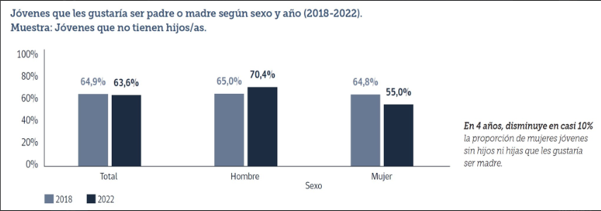
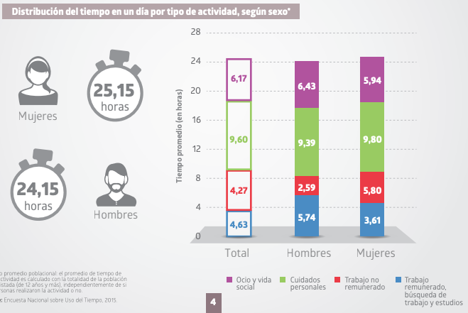
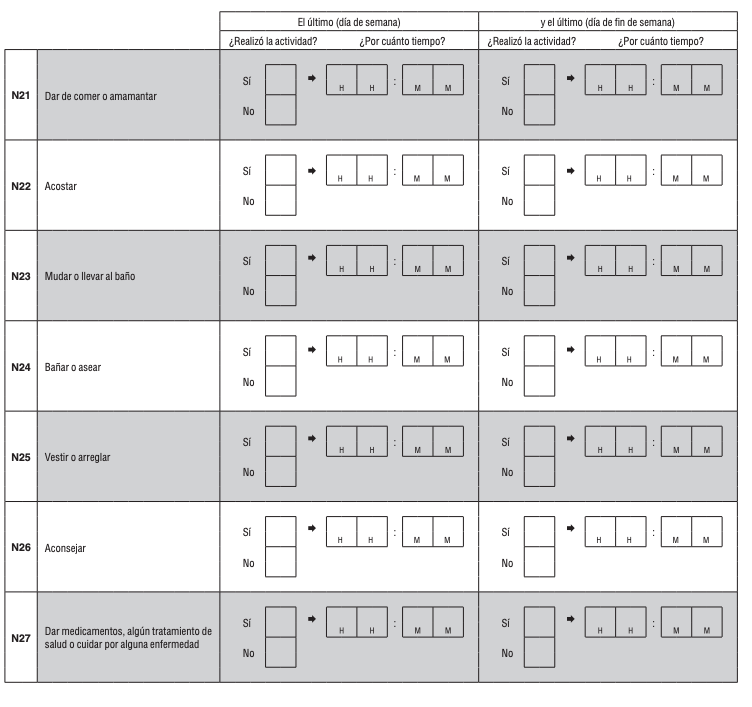
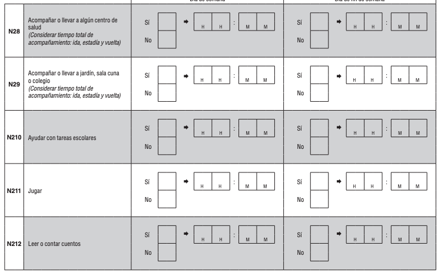
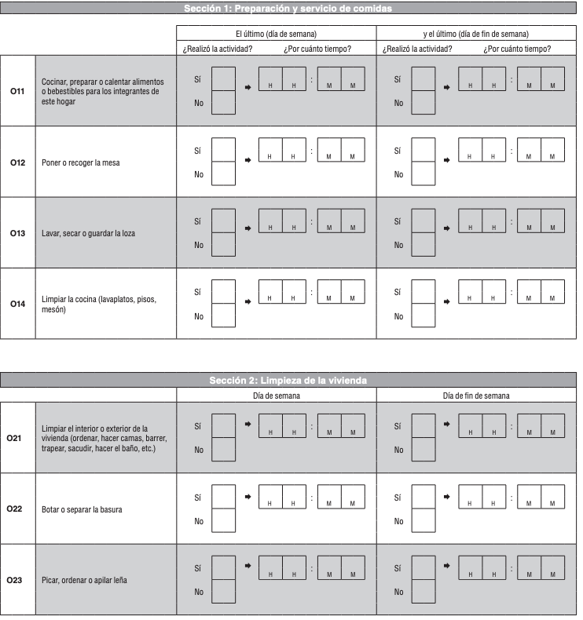
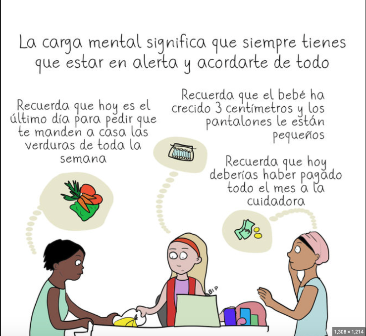
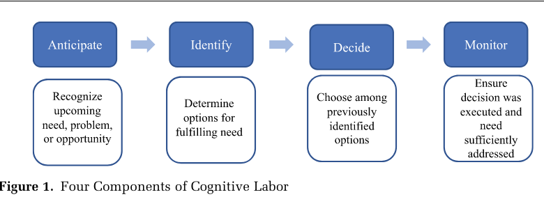
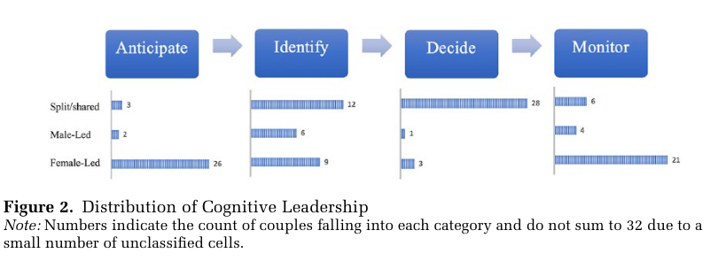

---

# Familia y Ma/Paternidades {background-image="C10_01.jpg" background-size="cover" background-opacity="0.35" style="color:white;"}

::: {style="color:#d4b8f5; font-size:1.1em; margin-top:0.5em;"}
SOL191 · Clase 10: Familia y Ma/Paternidades
:::

---

## Objetivos de hoy

::: {style="font-size:0.88em; line-height:1.8;"}
1. Describir la desigualdad de género en la familia en Chile: quién sostiene, quién cuida y quién cuenta con el tiempo.
2. Comparar tres lentes teóricos para explicar cómo se reproduce: segunda jornada, maternidad intensiva y carga cognitiva.
3. Analizar cómo el mercado laboral y las políticas moldean las decisiones de ma/paternidad (Bass, Berniell et al.).
4. Aplicar el sistema multinivel a la parentalidad gay en Chile.
:::

---

## Familia

::: {style="font-size:0.88em;"}
- [Amor y cuidado]{.hl}, pero también diferencia y desigualdad.
- Desafíos con la incorporación de la mujer al mundo laboral: falta de tiempo para realizar todas las tareas del hogar y tener un empleo remunerado.
- [Ideología de maternidad intensiva]{.hl}: la crianza debe tomar mucho tiempo, energía y recursos materiales, debe ser la prioridad sobre otros intereses, y debe ser realizada por las madres.
:::

---

## Familia en Chile: mujeres sostenedoras de hogar

::: {style="font-size:0.82em;"}
::: {.cuadro-datos}
En 2023-2024, el **43,8%** de las mujeres ocupadas es proveedora principal del hogar, lo que implica un alza de 14,4 puntos porcentuales en los últimos 13 años.
:::

- Han aumentado la proporción de mujeres solteras, y en menor medida de mujeres convivientes y divorciadas.
- Una parte minoritaria se debe a mujeres que viven con un hombre ocupado (es decir, que ganan más que el hombre).
- Alza en educación universitaria de mujeres, dando acceso a mayor autonomía económica.
- Ha habido un aumento en la diversidad de configuraciones familiares.
:::

---

## Baja de fecundidad

{fig-align="center" width="88%"}

::: {style="font-size:0.75em; margin-top:0.3em;"}
- Tasa global de fecundidad (número promedio de hijos o hijas que nacerían de una mujer a lo largo de su vida fértil, si se mantuvieran las tasas de fecundidad por edad registradas en un año o periodo determinado): [0,93 hijos/as]{.hl}.
- Chile hoy es uno de los países con menor tasa de fecundidad del continente.
- Cada vez menos mujeres quieren ser madres, quieren serlo a edades más avanzadas, y quieren tener sólo un hijo/a.
:::

---

## Uso del tiempo en Chile: quién hace el trabajo no remunerado

::: {style="font-size:0.85em;"}
{fig-align="center" width="62%"}

- Mujeres: ~[5,8 horas]{.hl} diarias de trabajo no remunerado y ~3,6 de trabajo remunerado. Hombres: ~2,6 y ~5,7 horas.
- Sumando ambos, las mujeres trabajan más horas al día (~9,4 vs ~8,3), pero **menos de ese tiempo es pagado**.
:::

---

## ¿Cómo se mide el cuidado? Cuestionario ENUT

::: columns
::: {.column width="50%"}
{fig-align="center"}
:::
::: {.column width="50%"}
{fig-align="center"}
:::
:::

---

## ¿Cómo se mide el trabajo doméstico? Cuestionario ENUT

{fig-align="center" width="55%"}

---

## División del trabajo en el hogar en parejas heterosexuales

::: {style="font-size:0.85em;"}
- **Perspectiva tradicionalista:** los hombres deben ser responsables de proveer económicamente y las mujeres deben ser responsables del trabajo de cuidado.
- **Perspectiva neo-tradicionalista:** los hombres se enfocan en el trabajo y las mujeres pueden trabajar si quieren, pero sólo si no interfiere con su "real" trabajo de cuidar a su familia.
- **Perspectiva igualitaria:** división relativamente simétrica entre ambos tipos de trabajo.
:::

---

## Principales barreras para el trabajo compartido o división igualitaria

::: {style="font-size:0.82em;"}
- Institucionales:
  - La familia y el trabajo remunerado como [instituciones avaras]{.hl} (Coser 1974; Goldin 2014) que demandan mucho tiempo y energía, y hay altas expectativas de dedicación.
  - Políticas públicas que restringen acceso a beneficios o responsabilidades por género.
- Ideológicas: creencias de maternidad intensiva (Hays 1996), normas de género, expectativas sociales.
- En conjunto con la desigualdad de género en el trabajo, esto muchas veces lleva a la especialización a pesar de aspiraciones igualitarias: [maximización económica]{.hl}.
:::

---

## Tres lentes para entender la desigualdad en la familia

::: {style="font-size:0.78em;"}
::: columns
::: {.column width="48%"}
::: {.cuadro-datos}
**Segunda jornada** (Hochschild 1989)

Las mujeres con empleo remunerado asumen además el grueso del trabajo doméstico y de cuidado; las parejas construyen relatos para justificar el reparto.
:::

::: {.cuadro-datos}
**Maternidad intensiva** (Hays 1996)

Ideología cultural: la crianza es exigente, centrada en el/la hijo/a y responsabilidad de la madre.
:::
:::
::: {.column width="48%"}
::: {.cuadro-datos}
**Carga cognitiva** (Daminger 2019)

El trabajo invisible de anticipar, identificar, decidir y monitorear las necesidades del hogar.
:::

::: {.cuadro-actividad}
¿En qué nivel opera cada lente: individual (micro), interaccional (meso) o institucional (macro)? ¿Cuál explica mejor los datos de uso del tiempo que acabamos de ver?
:::
:::
:::
:::

---

## Preparing for Parenthood? (Bass 2015)

::: {style="font-size:0.82em;"}
- Entrevistas en profundidad con 60 hombres y mujeres sin hijos/as, en 30 parejas heterosexuales viviendo en San Francisco, EEUU.
- 73% de las parejas estaban casadas, la gran mayoría por más de 3 años.
- 27% estaban comprometidas o conviviendo.
- Entre 25 y 34 años.
- Ideologías de género igualitarias.

::: {.cuadro-datos}
¿Los planes de tener hijos/as en el futuro afectan de manera diferente las aspiraciones y decisiones de carrera de mujeres y hombres?
:::
:::

---

## Actividad en grupos

::: {style="font-size:0.85em;"}
::: {.cuadro-actividad}
Actividad en grupos de 2-4 personas.

En el artículo identificar ejemplos de cómo hombres y mujeres viven los distintos procesos:

1. Procesos mentales sobre el rol de ma/paternidad en sus trayectorias de carrera (páginas 369-373).
2. Procesos emocionales sobre la preparación para la intersección futura de trabajo y ma/paternidad (páginas 373-375).
3. Procesos de comportamiento sobre el ajuste de los objetivos de carrera en anticipación a la ma/paternidad (375-380).

Ir anotando en la pizarra en la medida que los encuentran.
:::
:::

---

## Actividad en grupos: principales hallazgos (Bass 2015)

::: {style="font-size:0.62em;"}
| Proceso | Mujeres | Hombres |
|---|---|---|
| **1. Mental** (trabajo mental de anticipar la ma/paternidad) | 77% menciona hijos/as o cuidado al imaginar su carrera en 5-10 años, sin que se les pregunte. Incertidumbre: "Maybe I'll just be a mom. Maybe I'll be working part-time" (Marcella). Se ven como "las planificadoras". | Solo 10% lo menciona. Ven su carrera con un lente centrado solo en el trabajo: más senioridad, emprender, autonomía. "That's a good question... I don't know" (Donald). Les preocupa conservar "su tiempo". |
| **2. Emocional** (preparar la intersección trabajo-ma/paternidad) | Estrés y ansiedad: "It freaks me out!". Presión por calzar estudios y carrera con el calendario de la maternidad (Allie y el MBA). Doble juicio: trabajar full-time, part-time o quedarse en casa siempre será criticado (Denise). | Libres de esas consecuencias emocionales: ningún hombre que planeaba estudiar o cambiar de trabajo mencionó ansiedad por coordinarlo con la paternidad. |
| **3. Comportamiento** (ajuste de metas de carrera) | Asumen que sus preferencias cambiarán con los hijos/as y posponen estudios (Lacy, Jessica). Se anticipan como cuidadoras principales: renuncian a cargos de liderazgo (Betsy), se quedan en empleos "buenos para tener hijos" (Erin), eligen sectores más flexibles y peor pagados (Paula: derecho público; médica → asistente médica). | Pocos ajustan sus metas, y si lo hacen es para "acelerar" según el rol de proveedor: más sueldo y estabilidad (Charles, Toby, Zach). El MBA y los ascensos siguen en pie. |
:::

::: {.cuadro-datos style="font-size:0.7em;"}
Resultado: las trayectorias de mujeres y hombres se separan **antes** de tener hijos/as, aun en parejas igualitarias que casi nunca han conversado el tema. "His salary is gonna ultimately completely eclipse mine" (esposa de Zach).
:::

---

## Dimensión cognitiva y emocional del trabajo doméstico

{fig-align="center" width="70%"}

---

## Modelo de trabajo cognitivo doméstico

{fig-align="center" width="70%"}

---

## La dimensión cognitiva del trabajo doméstico (Daminger 2019)

::: {style="font-size:0.85em;"}
La dimensión cognitiva implica:
:::

{fig-align="center" width="65%"}

---

## Diferencias de género

{fig-align="center" width="80%"}

---

## Maternidad y empleos flexibles en América Latina (Berniell et al. 2023)

::: {style="font-size:0.78em;"}
::: columns
::: {.column width="52%"}
::: {.cuadro-datos}
**Diseño**

Estudio de eventos alrededor del nacimiento del primer hijo/a, con datos de panel de encuestas de hogares de Chile, México, Perú y Uruguay.
:::

- La maternidad **reduce la oferta laboral** de las mujeres (probabilidad de trabajar y horas).
- Las madres se desplazan hacia ocupaciones "flexibles": [jornada parcial, trabajo por cuenta propia e informalidad]{.hl}.
- En Chile, el efecto negativo persiste hasta [10 años]{.hl} después del nacimiento.
:::
::: {.column width="44%"}
::: {.cuadro-datos}
**Contexto**

Los países con normas de género más conservadoras y políticas familiares menos generosas tienen mayores brechas entre madres y no madres.
:::

::: {.cuadro-actividad}
¿Es la flexibilidad una solución para conciliar o una trampa? ¿Qué políticas cambiarían el resultado: sala cuna universal, postnatal compartido, flexibilidad laboral para ambos?
:::
:::
:::
:::

---

## Estereotipos de ma-paternidad

::: {style="font-size:0.85em;"}
- Estereotipos y representaciones en los medios sobre la ma-paternidad son generizados.
- Estas representaciones se ven claramente en los medios, películas, redes sociales, etc.
- *https://www.youtube.com/watch?v=jHPbOGEUvZA*
- *https://www.youtube.com/watch?v=ASegpS-WDIU*

::: {.cuadro-actividad}
¿Qué estereotipos reproducen estas representaciones?
:::
:::

---

## Parentalidad de hombres gay en Chile (Herrera et al. 2018)

::: {style="font-size:0.85em;"}
- Entrevistas a 14 padres que se autoidentifican como hombres gay.
- Entre 25 y 60 años.
- Casi todos con educación universitaria.
- 5 fueron padres en relación homosexual.
- 9 fueron padres en relación heterosexual.
:::

---

## Parentalidad de hombres gay en Chile (Herrera et al. 2018)

::: {style="font-size:0.78em;"}
::: columns
::: {.column width="50%"}
**¿Cuáles son los principales desafíos que enfrentan los padres gay entrevistados?**

- La paternidad gay transgrede normas de género que asocian el cuidado y la crianza con la feminidad y donde los hombres son personas secundarias.
- Enfrentan los estereotipos asociados a la homosexualidad y a la paternidad gay.
- Preocupación sobre cómo su homosexualidad puede afectar negativamente la vida de sus hijos/as.
:::
::: {.column width="50%"}
**¿Qué estrategias siguen para enfrentar estos desafíos?**

Estrategias de protección:

- Discreción/escudos de protección frente a entorno hostil.
- Apertura/transparencia:

::: {.cuadro-datos}
"No queremos darles a entender un mensaje erróneo de que es algo malo."
:::
:::
:::
:::

---

## Aplicando el sistema multinivel

::: {style="font-size:0.88em;"}
::: {.cuadro-actividad}
¿Qué aspectos...

- [individuales o micro]{.hl}
- [interaccionales o meso]{.hl}
- [institucionales o macro]{.hl}

...nos ayudan a comprender las experiencias de desigualdad que viven los padres gay en Chile?
:::
:::

---

## Reflexión final (Wooclap)

::: {style="font-size:0.85em;"}
::: columns
::: {.column width="60%"}
::: {.cuadro-actividad}
**5 minutos, en Wooclap:**

:::
:::
::: {.column width="38%"}
{fig-align="center"}
:::
:::
:::
