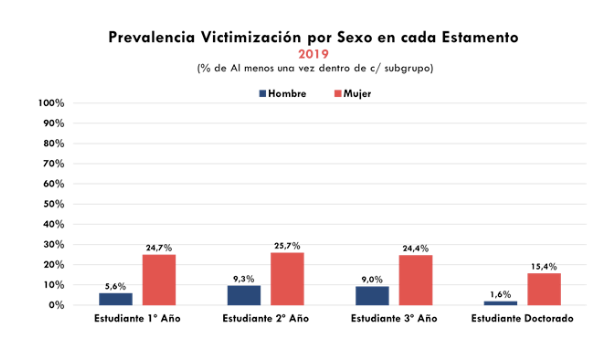
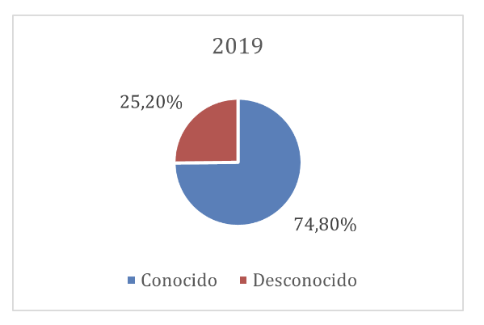
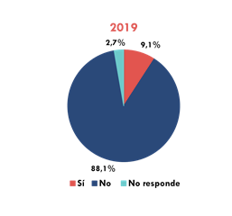

# Violencia de género {background-image="C11_01.jpg" background-size="cover" background-opacity="0.35" style="color:white;"}

::: {style="color:#d4b8f5; font-size:1.1em; margin-top:0.5em;"}
SOL191 · Clase 11: Violencia de género
:::

---

## Advertencia de contenido {background-color="#f8f4ff"}

::: {style="font-size:0.88em;"}
::: {.cuadro-actividad}
Hoy hablaremos de **violencia física, sexual, psicológica y digital, acoso, femicidio y abuso sexual**. Puede ser difícil o doloroso.

- Puedes **salir de la sala, tomar agua o una pausa** cuando lo necesites, sin pedir permiso ni dar explicaciones.
- Puedes **participar de forma más pasiva** y no es necesario compartir experiencias personales.
- Puedes **volver cuando quieras**.
- Si quieres conversar después, escríbeme a mí o a las ayudantes.
:::

::: {style="font-size:0.85em; margin-top:0.4em;"}
**Fono 1455** (SernamEG): orientación gratuita y confidencial en violencia de género.
:::
:::

::: notes
Leer con calma y dejar unos segundos antes de seguir. La columna de Manne que leeremos en clase cita lenguaje sexual explícito de un chat grupal: avisarlo antes de repartirla.
:::

---

## Objetivos de hoy

::: {style="font-size:0.85em; line-height:1.7;"}
1. Dimensionar la violencia de género en Chile con datos actuales y entender qué miden (y qué no) esas cifras.
2. Comparar dos teorías de la violencia: la misoginia como **control social** (Manne) y la violencia como **mensaje entre hombres** (Segato).
3. Analizar un caso reciente a partir de una columna de Manne: cómo los grupos de pares habilitan y encubren la violencia.
4. Discutir los alcances y límites de la respuesta institucional chilena (Ley 21.675, violencia digital).
:::

---

## ¿Qué tan extendida es? Encuesta Nacional de Violencia contra las Mujeres 2024

::: {style="font-size:0.8em;"}
::: columns
::: {.column width="50%"}
::: {.cuadro-datos}
**1 de cada 3** mujeres (33,4%) ha sufrido violencia psicológica, física o sexual en su vida; **1 de cada 5** (20,3%) en el último año.
:::

- Psicológica: 28,6% vida · 18,5% año
- Física: 10,9% vida · 3,5% año
- Sexual: 8,7% vida · 3,2% año
- Agresor principal más frecuente: **ex pareja** (33% en violencia psicológica, 35% en física)
:::
::: {.column width="48%"}
::: {.cuadro-datos}
**41,4%** ha sufrido violencia en **espacios públicos** alguna vez (31,3% insultos sexuales; 22,5% tocaciones sin consentimiento).
:::

- Solo **12,1%** denunció el último episodio de violencia sexual (16,3% en 2020).
:::
:::

::: {style="font-size:0.7em; color:#777;"}
Fuente: Subsecretaría de Prevención del Delito, ENVCM 2024. Mujeres de 15 a 65 años, zonas urbanas, muestra probabilística (n = 7.100).
:::
:::

::: notes
La violencia general bajó significativamente entre 2020 y 2024 (vida 41,4% → 33,4%; año 21,7% → 20,3%). Preguntar: ¿por qué podría bajar la prevalencia y, al mismo tiempo, bajar la denuncia de la violencia sexual? Posibles respuestas: cambios reales, cambios en la disposición a reportar en la encuesta, desconfianza en las instituciones. Motivos de no denuncia de violencia sexual más frecuentes en 2024: no sabía que podía denunciar, vergüenza, miedo, creer que denunciar no sirve.

Esta encuesta mide sobre todo violencia de pareja, familia y espacios públicos/laborales/educativos: no mide la violencia digital como categoría propia. Retomarlo con Ananías.
:::

---

## Femicidios en Chile

::: {style="font-size:0.85em;"}
::: columns
::: {.column width="50%"}
::: {.cuadro-datos}
En 2024: **43 femicidios consumados**, **319 frustrados** y **80 tentados** (SernamEG).
:::

- Los consumados se mantienen estables (43-44 por año desde 2020).
- Los frustrados se han **duplicado**: 151 en 2020 → 319 en 2024.
:::
::: {.column width="48%"}
::: {.cuadro-actividad}
¿Qué indica que los consumados se mantengan y los frustrados aumenten? ¿Más violencia, más registro o más intervención a tiempo?
:::
:::
:::
:::

::: notes
Cifras de SernamEG, reportadas por La Tercera y BioBioChile (2025). El Poder Judicial registra 44 consumados en 2024 por diferencias de clasificación. En 2024, 29% de las víctimas de femicidio consumado y 48% de las de femicidio frustrado tenían denuncias previas: es un dato clave para hablar de la respuesta institucional. Para 2025, la prensa reporta unos 330 frustrados y 43-44 consumados según SernamEG (47 según la Red Chilena contra la Violencia hacia las Mujeres): verificar en sernameg.gob.cl antes de la clase si se quiere usar 2025. Mencionar que la Red Chilena registra más femicidios porque usa una definición más amplia.
:::

---

## Abuso sexual en la niñez: Primera Encuesta Nacional (CUIDA UC)

::: {style="font-size:0.78em;"}
::: columns
::: {.column width="50%"}
::: {.cuadro-datos}
**18%** de la población adulta sufrió abuso sexual antes de los 18 años: [28% de las mujeres]{.hl} y 8% de los hombres. Un 5% sufrió violación.
:::

- Más de la mitad (55%) ocurrió entre los **6 y 12 años**.
- **94%** de los ofensores son hombres (98% en el caso de las niñas; 76% en el de los niños).
- **77%** de los ofensores eran conocidos: familiares (41%, sobre todo tíos, primos y padrastros) o conocidos de la familia (36%).
:::
::: {.column width="48%"}
::: {.cuadro-datos}
**38%** nunca se lo contó a nadie, y casi la mitad (48%) de quienes lo contaron tardaron **10 años o más**.
:::

- Solo **9%** denunció y 17% recibió atención especializada o tratamiento de salud mental.

::: {.cuadro-actividad}
¿Qué mecanismos de Armstrong et al. (silencio, poder de definir) y de Segato (en el hogar "porque puede") ayudan a entender estos datos?
:::
:::
:::

::: {style="font-size:0.68em; color:#777;"}
Fuente: CUIDA, Centro de Investigación del Abuso y la Adversidad Temprana (UC y Fundación Para la Confianza). Encuesta probabilística a 2.101 personas de 18 a 65 años en 13 regiones, diciembre 2021 a enero 2022.
:::
:::

::: notes
Definición del estudio: abuso sexual infantil cuando la víctima es menor de 18 años y el ofensor tiene 12 años o más; se mide con preguntas autoaplicadas basadas en la clasificación NIS-3, con encuestadoras mujeres. Las cifras se comparan con meta-análisis internacionales: Pereda et al. (2009) 19,2% mujeres y 7,4% hombres; Stoltenborgh et al. 18,4% y 7,6%. Es decir, la prevalencia en mujeres en Chile es más alta que los promedios internacionales.

Otros datos útiles: el ofensor más frecuente tiene entre 35 y 54 años (53%), pero 19% tenía entre 12 y 17. Un 10% es abuso entre pares (menos de 5 años de diferencia). Los mecanismos más usados por el ofensor: abusar de la confianza (37%), usar fuerza física (26%), obligar a guardar secreto (26%). 27% de quienes vivieron estas experiencias no se considera víctima de abuso sexual (los hombres se consideran víctimas menos que las mujeres: 63% vs. 76%), lo que conecta con el "poder de definir" de Armstrong et al. y con la contra-pregunta de Ananías et al.

Para discutir con mirada metodológica: la prevalencia reportada es mayor entre personas con educación superior (22%) que con educación básica (13%). ¿Más abuso o más capacidad de reconocerlo y reportarlo?

Quienes vivieron abuso sexual en la niñez reportan más trastornos de salud mental diagnosticados (50% vs. 25% al menos uno) y más problemas con drogas (36% vs. 13%). El ambiente protector (un adulto que cuida, rutina estable, amistades) aparece asociado a menor abuso.
:::

---

## Cifras PUC: violencia sexual (2019)

::: columns
::: {.column width="60%"}
{fig-align="center"}
:::
::: {.column width="38%"}
{fig-align="center"}

{fig-align="center"}
:::
:::

::: notes
Prevalencia de victimización por sexo y estamento (2019): entre estudiantes de pregrado, alrededor de 1 de cada 4 mujeres vs. 6-9% de los hombres. Agresor conocido: 74,8%. PENDIENTE: confirmar a qué pregunta corresponde el gráfico de Sí/No/No responde (¿denunció?) y agregarle título. Revisar si existe una medición PUC más reciente que la de 2019.
:::

# ¿Cómo explicamos la violencia? {background-color="#6B4C9A" style="color:white;"}

---

## La violencia sexual como mecanismo de desigualdad (Armstrong et al. 2018)

::: {style="font-size:0.72em;"}
::: {.cuadro-datos}
La violencia sexual es **causa y consecuencia** de múltiples desigualdades, y es más eficaz porque se [silencia]{.hl}.
:::

::: columns
::: {.column width="50%"}
- **Poder:** dominación, no desviación individual.
- **Interseccionalidad:** mirar solo el género (o solo la raza) deja fuera a muchas víctimas.
- **Organizaciones:** universidades, iglesias o ejércitos la facilitan y encubren.
:::
::: {.column width="48%"}
- **Cultura:** guiones sexuales y **mitos de violación** que culpan a la víctima.
- **Masculinidades:** sostiene la masculinidad y las jerarquías entre hombres.
- **Poder de definir:** quién decide qué cuenta como violencia.
:::
:::
:::

::: notes
Versión completa de la slide. La violencia sexual es causa y consecuencia de desigualdades de género, raza/etnia, clase, sexualidad, edad, discapacidad y ciudadanía. Poder: es dominación (p. ej., violación como arma de guerra y de colonización). Interseccionalidad: las políticas centradas solo en género o solo en raza fallan a las mujeres de color (Crenshaw, Collins). Organizaciones: también cárceles y lugares de trabajo. Cultura: guiones heterosexuales en que él insiste y ella resiste. Poder de definir: en la ley, en la cultura y en la propia experiencia.

Armstrong, Gleckman-Krut & Johnson (2018), Annual Review of Sociology 44: 99–122. Siete "insights": poder, interseccionalidad, organizaciones e instituciones, cultura, discurso e interacción, masculinidades y narrativa. Se apoyan en Collins: la violencia es el "pegamento conceptual" que une los sistemas de dominación. El foco es Estados Unidos: preguntar qué cambia en Chile (por ejemplo, clase y pueblos originarios en lugar de raza en el sentido estadounidense). Conectar "organizaciones" con la columna de Manne: Armstrong et al. (2006) mostraron cómo la organización de la vida universitaria (residencias, control masculino de las fiestas) produce agresiones sexuales en el campus; y Sanday (2007, citado en p. 114) muestra que los grupos solo de hombres atacan a mujeres para renovar sus lazos. Ambas ideas son el puente directo con Segato y con el caso de Cornell.
:::

---

## El mito de la "violación real" (Armstrong et al. 2018)

::: {style="font-size:0.72em;"}
::: columns
::: {.column width="50%"}
::: {.cuadro-datos}
**El arquetipo:** un desconocido ataca con violencia a una mujer "respetable", que resiste y denuncia.
:::

**La evidencia:**

- La mayoría **conoce** a su agresor.
- La mayoría **no denuncia**; muchas **no lo nombran** como violación.
- Denuncias falsas: **2–10%**, como en otros delitos.
:::
::: {.column width="48%"}
**Instituciones:**

- **"Segundas agresiones"** en policía, tribunales y salud.
- Límites del **feminismo carcelario**.
- **Silencio sociológico** sobre el tema.

::: {.cuadro-actividad}
¿Se parece este arquetipo a los datos de Chile que vimos?
:::
:::
:::
:::

::: notes
Versión completa de la slide. Evidencia: muchas víctimas no se resisten físicamente y la mayoría de los agresores no usa fuerza física ni armas. "Segundas agresiones": policía, fiscalía, tribunales y servicios médicos evalúan la credibilidad según edad, raza, clase o sexualidad. Feminismo carcelario: apostar solo por la vía penal dejó fuera a mujeres racializadas y pobres. Silencio sociológico: entre 1975 y 2017, las tres revistas centrales de la disciplina publicaron solo 13 artículos sobre violencia sexual. Pregunta ampliada: ¿cuánto se parece el arquetipo a la imagen que circula en los medios y en nuestras conversaciones?

Datos de Chile que lo confirman: en la ENVCM 2024 el principal agresor es la ex pareja y solo 12,1% denunció el último episodio de violencia sexual; en la PUC (2019), 74,8% de los agresores eran conocidos. Sobre denuncias falsas: Armstrong et al. explican que el estudio de Kanin (1994), que afirmaba 41% de denuncias falsas, tenía graves problemas metodológicos y sigue citándose pese a estar refutado (pp. 112–113). Las "segundas agresiones" conectan con el caso Rifo (Corte Suprema) y con las dificultades de denuncia que reportan Ananías et al. (Fiscalía que archiva). Sobre el movimiento: en Estados Unidos, la alianza con la "guerra contra el crimen" y la Violence Against Women Act de 1994 reforzaron el castigo penal; Richie y Crenshaw critican sus efectos sobre mujeres racializadas; alternativas: organización comunitaria y justicia restaurativa. Esto prepara el plenario sobre cómo abordar el problema. Sobre el silencio: AJS, ASR y Annual Review of Sociology publicaron 13 artículos entre 1975 y 2017; solo 5% de las publicaciones de ciencias sociales sobre violación en 1975–2015 aparecieron en revistas de sociología.
:::

---

## Misoginia según Manne

::: {style="font-size:0.78em;"}
*(Manne 2018, Down Girl)*

::: {.cuadro-datos}
La misoginia no es solo odio individual: es un [sistema de control social]{.hl} que fiscaliza la subordinación de las mujeres.
:::

- **Sexismo:** la ideología que justifica el orden de género.
- **Misoginia:** "la policía" que castiga a quienes lo desafían.

::: {.cuadro-actividad}
¿Ejemplos de mujeres que desafían las normas y son fiscalizadas? ¿Y de hombres?
:::
:::

::: notes
Versión completa: más allá del odio u hostilidad individual, la misoginia funciona para fiscalizar y asegurar la subordinación de las mujeres y mantener normas patriarcales. El castigo misógino recae sobre las mujeres que desafían las normas de género o que fracasan en servir los intereses de los hombres, e incluye abuso verbal, violencia física y aislamiento social, entre otras formas.
:::

---

## Himpathy e injusticia epistémica

::: {style="font-size:0.74em;"}
::: columns
::: {.column width="50%"}
::: {.cuadro-datos}
**"Himpathy"** (Manne): simpatía excesiva hacia los hombres que ejercen violencia, que protege su futuro y culpa a la víctima.
:::

**Caso Pradenas** (condenado en 2023): el debate se centró en su familia, su estatus y su futuro.
:::
::: {.column width="48%"}
::: {.cuadro-datos}
**Injusticia epistémica** (Fricker): se resta credibilidad a las mujeres como testigos de su propia experiencia.
:::

**Caso Nabila Rifo:** en 2017 la Corte Suprema descartó el femicidio frustrado porque "no quedó demostrado cabalmente el dolo de matar".
:::
:::
:::

::: notes
Versión completa: Pradenas fue condenado en 2023 a 17 años por siete delitos sexuales contra seis personas, entre ellas Antonia Barra. La Corte Suprema recalificó el femicidio frustrado de Rifo como lesiones graves y rebajó la condena del agresor. La injusticia epistémica es un concepto de Miranda Fricker que Manne usa.
Pradenas: un primer juicio (2022) lo condenó a 20 años, pero fue anulado por la Corte Suprema por falta de imparcialidad de un juez; el segundo juicio (julio 2023, Temuco) lo condenó a 17 años. Rifo: agresión en Coyhaique en mayo de 2016; la Corte Suprema (11 julio 2017, 4 votos contra 1) recalificó el femicidio frustrado y rebajó la condena de 26 años a 18. Preguntar: ¿qué tiene que demostrar una mujer para que su testimonio se tome en serio? Conectar con la denuncia baja que vimos en la ENVCM ("temor a que no me creyeran").
:::

---

## Segato: la violencia como mensaje

::: {style="font-size:0.76em;"}
*(Segato 2016, cap. 1, selección de pasajes)*

::: {.cuadro-datos}
La violación es violencia [expresiva]{.hl} más que instrumental: su fin es expresar el control absoluto de una voluntad sobre otra. Por eso es un **enunciado**, y se dirige a interlocutores.
:::

::: columns
::: {.column width="50%"}
**Eje vertical:** el agresor habla a la víctima. Se presenta como "moralizador": la mujer debe ser contenida, disciplinada.

**Eje horizontal** (su mayor aporte): habla a **sus pares**. Pide ingreso a la "hermandad viril" y compite por un lugar en ella.
:::
::: {.column width="48%"}
- La masculinidad es un **estatus** que se conquista y debe reconfirmarse, mediante un **tributo** que entregan las mujeres.
- Los violadores, la mayoría de las veces, "no actúan en soledad".
- En el hogar el hombre abusa **porque puede**; en el espacio público, **para demostrar que puede**.
:::
:::
:::

::: notes
Todo esto está en la selección asignada (pp. 37–47). Segato desarrolla el modelo a partir de entrevistas con condenados por violación en la cárcel de Brasilia (1993–1995) y lo aplica a los feminicidios de Ciudad Juárez. Conceptos como "mandato de masculinidad" y "pedagogía de la crueldad" aparecen en otros capítulos del libro, no en la selección: si se mencionan, aclararlo. Último pasaje de la selección: culpar a las víctimas como mecanismo colectivo para reducir la disonancia ("debe haber una razón"), lo que conecta directamente con la himpathy de Manne.
:::

---

## Manne y Segato: ¿en qué se parecen y en qué difieren?

::: {style="font-size:0.78em;"}
| | **Manne** | **Segato** |
|---|---|---|
| ¿Qué es la violencia? | Castigo: **control social** sobre mujeres que desafían el orden | **Mensaje**: acto expresivo de dominio |
| ¿A quién se dirige? | A la mujer que transgrede (y a todas, como advertencia) | A la víctima **y a los otros hombres** |
| ¿Qué la sostiene? | La himpathy y el descrédito de las víctimas | La hermandad masculina y el mandato de demostrar masculinidad |

::: {.cuadro-actividad}
En parejas (3 min): piensen en un caso de violencia de pareja en el hogar. ¿Qué teoría lo explica mejor? ¿Y un caso de violencia sexual grupal?
:::
:::

::: notes
Respuesta esperada: Manne se ajusta mejor a la violencia de pareja como castigo y control (y la ENVCM muestra que la ex pareja es el principal agresor, por ejemplo cuando ella termina la relación). Segato distingue explícitamente la violencia doméstica ("porque puede") de la pública ("para demostrar que puede"), y su eje horizontal explica mejor la violencia grupal. Esto prepara la actividad: el caso de la columna es exactamente un caso grupal.
:::

---

## Actividad: lectura y discusión de la columna de Manne {background-color="#f8f4ff"}

::: {style="font-size:0.78em;"}
Manne, K. (2026, 20 de octubre). "What Makes Men in Groups Behave So Badly?" *The New York Times*.

Caso: el chat grupal de la fraternidad Chi Phi (Cornell) la noche en que una estudiante ("Jane Doe") denuncia haber sido agredida sexualmente por siete hombres.

::: {.cuadro-actividad}
**1. Lectura individual (10 min).** Mientras leen, marquen:

- un pasaje que ilustre la **himpathy**,
- un pasaje que ilustre el **eje horizontal** de Segato (hablarle a los pares),
- un dato o evidencia que use Manne.
:::

**Advertencia:** la columna cita lenguaje sexual explícito del chat.
:::

::: notes
Repartir la columna impresa o en Canvas. Son 5 páginas cortas en inglés. Si el tiempo es poco, se puede asignar como lectura previa y usar estos 10 minutos para releer los pasajes marcados en grupo.
:::

---

## Actividad: discusión en grupos (25 min) {background-color="#f8f4ff"}

::: {style="font-size:0.74em;"}
::: {.cuadro-actividad}
**En grupos de 4.**

**A. Mecanismos (8 min).** ¿Cómo explica Manne que hombres que "eran algo así como amigos" de Jane Doe la ofrecieran al grupo? Identifiquen en el texto el **"bro code"**, el **silencio** de quienes vieron el chat y la **himpathy** posterior (¿quiénes terminan sintiéndose víctimas?).

**B. Teoría (8 min).** El chat como "escenario": ¿qué mensajes se dirigen a la víctima y cuáles a los pares? ¿Qué agrega Segato que Manne no explica, o al revés? Usen el testimonio de Diego Estrada (ex presidente de una fraternidad).

**C. Evidencia (9 min).** Manne cita un estudio según el cual los hombres que entran a fraternidades tienen 3 veces más probabilidad de cometer violencia sexual en su primer año. ¿Cuánto apoya este dato la frase "las fraternidades pueden convertir hombres en violadores"? ¿Qué otra explicación habría que descartar?
:::
:::

::: notes
Pedir que citen pasajes concretos. Ronda A: dos de los acusados enviaron después mensajes de apoyo a Jane Doe ("I'm so so sorry", "You need anything?") y eran los mismos que la ofrecieron en el chat. Bro code: cuando un hombre propone algo inmoral o ilegal, los otros lo acompañan; la regla secundaria es no criticar ni intervenir. Nadie objetó abiertamente; varios escalaron; al menos dos entraron a la habitación tras ver el chat (un miembro sí compartió el chat, quizás por escrúpulo moral). Himpathy: en otras fraternidades se lamentaba que los acusados fueran "arruinados" y se culpaba a Jane Doe por beber e ir a la casa; un acusado se queja de sentirse abandonado por la "hermandad".

Ronda B: el chat es literalmente el eje horizontal de Segato. El emoji del diablo y el "CHI PHIII" muestran la masculinidad "performada, probada y celebrada" ante el grupo; el carácter prohibido es parte de la excitación colectiva. Estrada calló por no querer parecer un "moralista" y por miedo a perder su trabajo, alimentación y vivienda; su reflexión final ("mi trabajo es proteger a mis hermanos... versus la necesidad de ser una buena persona") muestra la lealtad al grupo por sobre la ética. Manne agrega la tecnología: los grupos se coordinan más fácil y a mayor escala (Pelicot en Francia, grupo de Facebook en Italia, chats documentados por CNN, el caso de Maddie Kowalski). Segato aporta la idea de la violencia como lenguaje que entienden "los avisados": en el chat ese lenguaje es literal.

Ronda C: Manne dice que esos hombres no tenían más probabilidad de haber agredido antes, lo que apunta a un efecto de la fraternidad; pero hay que discutir la autoselección (quién elige entrar) y otras variables. Para 4° año, es una buena oportunidad para hablar de causalidad. Datos de Cornell: 35% de las estudiantes de pregrado reporta alguna agresión sexual (encuesta 2025) vs. 23% en 2023. Equivalentes chilenos para el plenario: grupos de WhatsApp, equipos deportivos, colegios, y el **Caso Nido** (foro machista denunciado en 2019 que publicaba material íntimo de mujeres sin consentimiento; citado en Ananías et al. 2023, p. 17–18).
:::

---

## Plenario abierto: ¿cómo abordarlo? (15 min)

::: {style="font-size:0.88em;"}
::: {.cuadro-actividad}
Si el problema no es solo el individuo, sino el **grupo que habilita y calla** y las **instituciones que lo permiten**:

- ¿Cómo abordarían este problema? ¿Qué debería cambiar y quién es responsable de cambiarlo?
- Manne propone **prohibir las fraternidades**. ¿Están de acuerdo? ¿Cuál sería el equivalente en Chile?
:::
:::

::: notes
Plenario abierto, sin reporte por grupos: partir pidiendo propuestas concretas y luego tensionarlas. Posibles ejes:
(1) Prohibir o sancionar: Manne descarta suspender las fiestas (como la Ley Seca: lleva las prácticas a la clandestinidad) y propone prohibir las fraternidades; el ex presidente de fraternidad Estrada "casi" está de acuerdo, pero siente que traiciona a sus "hermanos". ¿Qué se pierde y qué se gana?
(2) Cambiar la norma del grupo: intervención de quienes observan, que denunciar no sea "traición"; ¿quién protege a quien interviene?
(3) Instituciones: Armstrong et al. muestran que las organizaciones facilitan y encubren la violencia, y que confiar solo en la vía penal tiene límites (feminismo carcelario; alternativas comunitarias y restaurativas). ¿Qué rol le cabe a la universidad?
(4) Plataformas: el chat y la difusión digital (Ananías et al.; Caso Nido en Chile).
Cerrar distinguiendo tres niveles: individual (el agresor), interaccional (el grupo) e institucional (universidad, plataformas, justicia), como en el sistema multinivel de clases anteriores.
:::

---

## Violencia digital en Chile (Ananías et al. 2023)

::: {style="font-size:0.72em;"}
::: columns
::: {.column width="52%"}
::: {.cuadro-datos}
Encuesta online a 531 mujeres (cis, trans y no binaries) en 2020, muestra **no probabilística** por cuotas (ONG Amaranta). **73,8%** había sufrido violencia digital.
:::

- Más reportado: violencia verbal (66,4%), acoso u hostigamiento (59%), **envío de fotos o videos de penes sin consentimiento** (49,6%).
- Agresores: anónimos o perfiles falsos (41,9%), pareja o ex pareja (18,1%), hombres del entorno (14,8%).
- **46,3%** de las encuestadas vivió control o violencia digital de una pareja (revisar el celular, exigir contraseñas o ubicación).
:::
::: {.column width="46%"}
- Solo 12,2% intentó denunciar, la mayoría sin respuesta positiva.
- No hubo más ataques a activistas que a no activistas: el **género** sería el principal factor de exposición.
- Al publicarse el estudio, Chile no tenía una ley integral sobre violencia digital.

::: {.cuadro-actividad}
El 73,8% incluye a 58 mujeres que primero dijeron que **no** habían sufrido violencia, pero luego describieron situaciones de control de su pareja. ¿Qué nos dice esto sobre cómo se mide (y se reconoce) la violencia?
:::
:::
:::
:::

::: notes
Corrección importante: el 49,6% es envío de imágenes de genitales masculinos sin consentimiento; la difusión no consentida de imágenes íntimas propias fue 3,2%. Las autoras señalan que esta forma de violencia estaba tan normalizada que ni ellas la habían reconocido como tal antes. Antes de la contra-pregunta el porcentaje era 62,9%. La violencia digital se entiende como un continuo de la violencia de género offline. El 12,2% corresponde a 41 casos. Los problemas para denunciar: Fiscalía archiva, falta de brigadas especializadas en regiones; las mujeres se apoyan en redes de amigas, familia y terapia ante el "abandono del Estado". Sobre la ley: Ley 21.675 (2024) no define la violencia digital como un tipo separado; la violencia simbólica incluye mensajes en "cualquier medio de comunicación o plataforma". Pregunta adicional: ¿qué no podemos concluir de una muestra no probabilística?
:::

---

## Reflexión final (Wooclap)

::: {style="font-size:0.88em;"}
::: {.cuadro-actividad}
**5 minutos, anónimo:**

- ¿Qué idea de hoy cambia cómo entiendes la violencia de género?

:::

::: {style="font-size:0.85em; margin-top:0.5em;"}
**Fono 1455** (SernamEG) · **Fono 149** (Carabineros, Fono Familia)
:::
:::

::: notes
Leer 2-3 respuestas en voz alta si el grupo se siente cómodo.
:::
