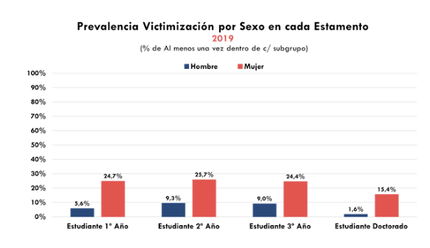
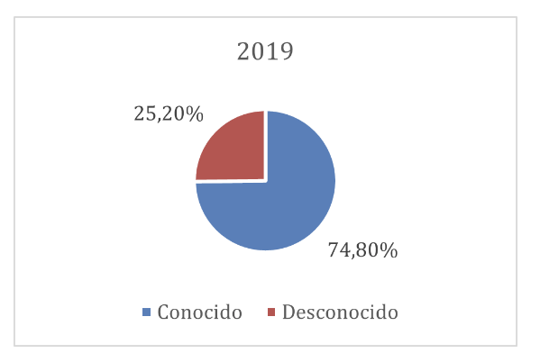
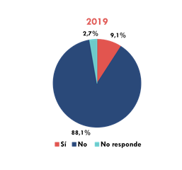

---

# Violencia de género {background-image="C11_01.jpg" background-size="cover" background-opacity="0.35" style="color:white;"}

::: {style="color:#d4b8f5; font-size:1.1em; margin-top:0.5em;"}
SOL191 · Clase 11: Violencia de género
:::

---

## Advertencia de contenido {background-color="#f8f4ff"}

::: {style="font-size:0.9em;"}
::: {.nonincremental}
::: {.cuadro-actividad}
Hoy hablaremos de **violencia física, sexual, psicológica y digital, acoso, femicidio y abuso sexual**. Puede ser difícil o doloroso, sobre todo si es parte de tu experiencia.

- Puedes **salir de la sala, tomar agua o una pausa** cuando lo necesites, sin pedir permiso ni dar explicaciones.
- Puedes **participar de forma más pasiva** o **no compartir** experiencias personales: nadie está obligado/a a hacerlo.
- Puedes **volver cuando quieras**; haremos pausas durante la clase.
- Si quieres conversar después, escríbeme a mí o a las ayudantes.
:::
:::
:::

::: notes
Leer con calma y dejar unos segundos antes de seguir. Recordar que el Fono 1455 (Sernameg) ofrece orientación gratuita y confidencial en violencia contra las mujeres.
:::

---

## Algunas cifras de Chile

::: {style="font-size:0.9em;"}
::: columns
::: {.column width="50%"}
::: {.cuadro-datos}
**1 de cada 4** mujeres fue víctima de violencia intrafamiliar en 2022.
:::

::: {.cuadro-datos}
El 2023, **43 femicidios** consumados y **259 frustrados** (Sernameg).
:::
:::
::: {.column width="50%"}
::: {.cuadro-datos}
Promedio de edad de primer abuso sexual (niños y niñas) es de **10,5 años** (2021).
:::

::: {.cuadro-datos}
**9 de cada 10** mujeres han sido víctimas de acoso sexual callejero al menos una vez en su vida.
:::
:::
:::
:::

---

## Cifras PUC: violencia sexual

::: columns
::: {.column width="60%"}
{fig-align="center"}
:::
::: {.column width="38%"}
{fig-align="center"}

{fig-align="center"}
:::
:::

---

## Misoginia según Manne

::: {style="font-size:0.85em;"}
*(Manne 2018)*

::: {.cuadro-datos}
Más allá del odio u hostilidad individual hacia las mujeres, la misoginia es un [sistema de control social]{.hl}. Funciona para fiscalizar y asegurar la subordinación de la mujer y mantener normas patriarcales.
:::

Sexismo es la ideología que racionaliza y justifica el patriarcado, mientras que la misoginia es "la policía" que castiga a quienes desafían este orden.

**El castigo misógino:** castigo a las mujeres que desafían las normas de género o fracasan en servir los intereses de los hombres.

  - Incluye el abuso verbal, la violencia física, el aislamiento social, entre otras.

::: {.cuadro-actividad}
¿Ejemplos de comportamientos o situaciones dónde las mujeres desafían las normas y pueden ser fiscalizadas? ¿Y de hombres?
:::
:::

---

## Misoginia y justicia (Manne)

::: {style="font-size:0.8em;"}
*(Manne 2018)*

::: {.cuadro-datos}
La sociedad ofrece **"himpathy"** o simpatía excesiva a quienes perpetúan violencia hacia las mujeres, minimizando sus acciones y/o culpando a las víctimas, lo que perpetúa el sistema patriarcal.
:::

- Caso Martín Pradenas: acusado de violencia sexual a varias mujeres durante años. El foco estuvo en Pradenas, su estatus y su familia, y en cómo una condena afectaría su futuro y reputación — quitando el foco al sufrimiento y trauma de sus víctimas.

::: {.cuadro-datos}
**Injusticia epistémica:** cuando los conocimientos, experiencias y voces de las mujeres son devaluados o ignorados, reforzando su estatus subordinado.
:::

- Caso Nabila Rifo: sobreviviente de intento de femicidio. Hubo escepticismo sobre su testimonio y foco en su vida personal y su personalidad, lo que distrae del crimen cometido contra ella.
:::

::: notes
"Himpathy" (Manne 2018): la simpatía se desplaza hacia el agresor y su futuro, y no hacia la víctima. En el caso Pradenas, el debate público se centró en su estatus, su familia y el efecto de una condena en su reputación, desplazando el foco del daño y el trauma de las víctimas.
:::

---

## Segato: violencia expresiva y mandato de masculinidad

::: {style="font-size:0.85em;"}
*(Segato 2016)*

::: {.cuadro-datos}
La violencia sexual no responde a un deseo sexual: es una violencia [expresiva]{.hl}, un acto de poder que se exhibe y se dirige también a otros hombres.
:::

- El agresor busca **reconocimiento y pertenencia** ante sus pares (la "cofradía masculina"), cumpliendo un **mandato de masculinidad**.
- La repetición de la violencia produce una **pedagogía de la crueldad**: se normaliza y se aprende.
- Por eso el agresor no es una "anomalía" individual: es el resultado de un orden de género.

::: {.cuadro-actividad}
¿Qué cambia si entendemos la violencia como mensaje a otros hombres y no solo como agresión a una víctima?
:::
:::

::: notes
Contrastar con Manne: ella pone el foco en el castigo a quienes desafían el orden; Segato, en la función del acto entre hombres. Revisar que lo resumido coincida con la introducción asignada.
:::

---

## Chile: marco legal y la Ley 21.675 (2024)

::: {style="font-size:0.82em;"}
::: columns
::: {.column width="48%"}
::: {.cuadro-datos}
**Hitos legales**

- Ley 20.480 (2010): tipifica el **femicidio**
- Ley 21.212 (2020, "Ley Gabriela"): incluye parejas sin convivencia
- Ley 21.565 (2023): protección y reparación a familias de víctimas de femicidio
- **Ley 21.675 (2024):** prevenir, sancionar y erradicar la violencia contra las mujeres por razón de género
:::
:::
::: {.column width="48%"}
::: {.cuadro-datos}
**Novedades de la Ley 21.675**

- Reconoce violencia **simbólica, institucional, política y gineco-obstétrica**
- Va más allá de la violencia en la pareja y la familia
:::
:::
:::
:::

---

## ¿Cómo se define la violencia de género en la ley?

::: {style="font-size:0.8em;"}
*(Valdebenito Zárate & Villena Llanos 2025)*

A partir de debates parlamentarios, informes de organizaciones feministas y entrevistas, identifican **cuatro marcos** para entender la violencia de género:

1. Violencia intrafamiliar
2. Violencia contra las mujeres por razón de género
3. Violencia de género desde una perspectiva feminista e interseccional
4. Violencia como problema no definido por el género

Encuentran **tensiones** entre la mirada institucional y las demandas históricas del movimiento feminista, y concluyen que la ley avanza pero reproduce algunas representaciones tradicionales y omite voces críticas.
:::

::: notes
Contextualizar con el resto de la clase: ¿qué marco predomina en las cifras que vimos? ¿Qué marcos de Manne y Segato quedan fuera de la ley?
:::

---

## Discusión en grupo: ley y definiciones de violencia

::: {style="font-size:0.9em;"}
::: {.cuadro-actividad}
- ¿Qué marco refleja mejor las cifras y los casos que vimos hoy (Pradenas, Rifo)?
- ¿Qué cambia en la política pública si la violencia se define como "intrafamiliar" o como "de género"?
- ¿Qué dimensiones de Armstrong et al. (2018) y Segato (2016) quedan fuera de la ley?
- ¿Qué actores deberían estar en la definición de la violencia?
:::
:::

::: notes
20 min en grupos.
:::

---

## Violencia digital: lo central de Ananías et al. (2023)

::: {style="font-size:0.72em;"}
::: columns
::: {.column width="52%"}
::: {.cuadro-datos}
**73,8%** de 531 mujeres encuestadas había sufrido violencia digital (muestra **no probabilística**, ONG Amaranta, inicio de la pandemia).
:::

- Más reportado: violencia verbal (66,4%), acoso (59%) e imágenes sexuales sin consentimiento (49,6%)
- Origen: anónimos o perfiles falsos (41,9%), pareja o ex pareja (18,1%), hombres del entorno (14,8%)
- 46,3% de quienes tuvieron pareja sufrió control mediante dispositivos
:::
::: {.column width="46%"}
- Consecuencias: efectos emocionales, en la autoestima, sentirse vigilada, aislamiento
- Solo 12,2% intentó denunciar, con poca respuesta positiva
- No hubo más ataques a activistas que a no activistas: el **género** es el principal factor
- La violencia está **normalizada**
:::
:::

::: {.cuadro-actividad}
¿Por qué no podemos generalizar el 73,8%? ¿Es menos "real" la violencia digital?
:::
:::

---

## Tipos de violencia de género (ONU Mujeres)

::: {style="font-size:0.62em;"}
::: columns
::: {.column width="62%"}
**Violencia contra mujeres y niñas en el ámbito privado**

- Violencia económica
- Violencia psicológica
- Violencia emocional
- Violencia física
- Violencia sexual

**Feminicidio**

- Asesinatos por honor

**Violencia sexual**

- Acoso sexual
- Violación
- Violación correctiva
- Cultura de la violación

**Trata de personas**

**Mutilación genital femenina**

**Matrimonio infantil**

**Violencia en línea o digital**

- Ciberacoso
- Sexteo o sexting
- Doxing
:::
::: {.column width="36%"}
{fig-align="center"}
:::
:::
:::

::: notes
Este tipo de violencia, también llamada maltrato en el hogar o violencia de pareja, es cualquier patrón de comportamiento que se utilice para adquirir o mantener el poder y el control sobre una pareja íntima. Una de las formas más comunes de violencia que sufren las mujeres.

15 minutos.
:::
