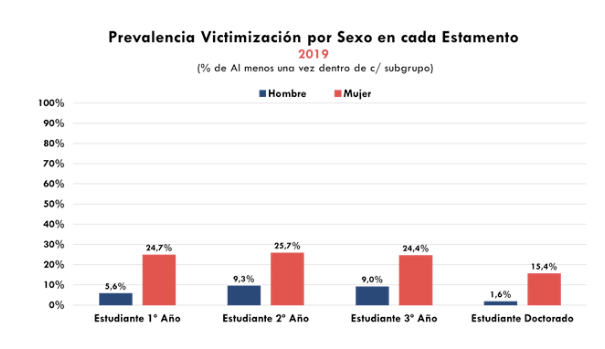
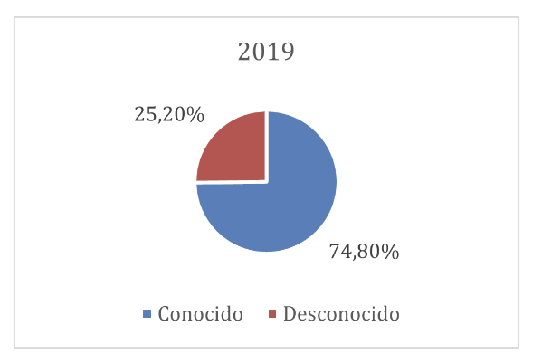
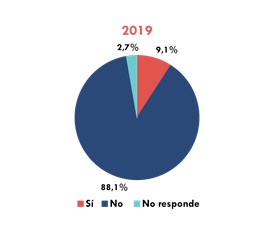

# Violencia de género {background-image="C11_01.jpg" background-size="cover" background-opacity="0.35" style="color:white;"}

::: {style="color:#d4b8f5; font-size:1.1em; margin-top:0.5em;"}
SOL191 · Clase 11: Violencia de género
:::

---

## Advertencia de contenido {background-color="#f8f4ff"}

::: {style="font-size:0.88em;"}
::: {.cuadro-actividad}
Hoy hablaremos de **violencia física, sexual, psicológica y digital, acoso, femicidio y abuso sexual**. Puede ser difícil o doloroso.

- Puedes **salir de la sala, tomar agua o una pausa** cuando lo necesites, sin pedir permiso ni dar explicaciones.
- Puedes **participar de forma más pasiva** y no es necesario compartir experiencias personales.
- Puedes **volver cuando quieras**.
- Si quieres conversar después, escríbeme a mí o a las ayudantes.
:::

::: {style="font-size:0.85em; margin-top:0.4em;"}
**Fono 1455** (SernamEG): orientación gratuita y confidencial en violencia de género.
:::
:::

---

## Objetivos de hoy

::: {style="font-size:0.85em; line-height:1.7;"}
1. Dimensionar la violencia de género en Chile con datos actuales y entender qué miden (y qué no) esas cifras.
2. Comparar dos teorías de la violencia: la misoginia como **control social** (Manne) y la violencia como **mensaje entre hombres** (Segato).
3. Analizar un caso reciente a partir de una columna de Manne: cómo los grupos de pares habilitan y encubren la violencia.
4. Discutir los alcances y límites de la respuesta institucional chilena (Ley 21.675, violencia digital).
:::

---

## ¿Qué tan extendida es? Encuesta Nacional de Violencia contra las Mujeres 2024

::: {style="font-size:0.8em;"}
::: columns
::: {.column width="50%"}
::: {.cuadro-datos}
**1 de cada 3** mujeres (33,4%) ha sufrido violencia psicológica, física o sexual en su vida; **1 de cada 5** (20,3%) en el último año.
:::

- Psicológica: 28,6% vida · 18,5% año
- Física: 10,9% vida · 3,5% año
- Sexual: 8,7% vida · 3,2% año
- Agresor principal más frecuente: **ex pareja** (33% en violencia psicológica, 35% en física)
:::
::: {.column width="48%"}
::: {.cuadro-datos}
**41,4%** ha sufrido violencia en **espacios públicos** alguna vez (31,3% insultos sexuales; 22,5% tocaciones sin consentimiento).
:::

- Solo **12,1%** denunció el último episodio de violencia sexual (16,3% en 2020).
:::
:::

::: {style="font-size:0.7em; color:#777;"}
Fuente: Subsecretaría de Prevención del Delito, ENVCM 2024. Mujeres de 15 a 65 años, zonas urbanas, muestra probabilística (n = 7.100).
:::
:::

---

## Femicidios en Chile

::: {style="font-size:0.85em;"}
::: columns
::: {.column width="50%"}
::: {.cuadro-datos}
En 2024: **43 femicidios consumados**, **319 frustrados** y **80 tentados** (SernamEG).
:::

- Los consumados se mantienen estables (43-44 por año desde 2020).
- Los frustrados se han **duplicado**: 151 en 2020 → 319 en 2024.
:::
::: {.column width="48%"}
::: {.cuadro-actividad}
¿Qué indica que los consumados se mantengan y los frustrados aumenten? ¿Más violencia, más registro o más intervención a tiempo?
:::
:::
:::
:::

---

## Abuso sexual en la niñez: Primera Encuesta Nacional (CUIDA UC)

::: {style="font-size:0.78em;"}
::: columns
::: {.column width="50%"}
::: {.cuadro-datos}
**18%** de la población adulta sufrió abuso sexual antes de los 18 años: [28% de las mujeres]{.hl} y 8% de los hombres. Un 5% sufrió violación.
:::

- Más de la mitad (55%) ocurrió entre los **6 y 12 años**.
- **94%** de los ofensores son hombres (98% en el caso de las niñas; 76% en el de los niños).
- **77%** de los ofensores eran conocidos: familiares (41%, sobre todo tíos, primos y padrastros) o conocidos de la familia (36%).
:::
::: {.column width="48%"}
::: {.cuadro-datos}
**38%** nunca se lo contó a nadie, y casi la mitad (48%) de quienes lo contaron tardaron **10 años o más**.
:::

- Solo **9%** denunció y 17% recibió atención especializada o tratamiento de salud mental.

::: {.cuadro-actividad}
¿Qué mecanismos de Armstrong et al. (silencio, poder de definir) y de Segato (en el hogar "porque puede") ayudan a entender estos datos?
:::
:::
:::

::: {style="font-size:0.68em; color:#777;"}
Fuente: CUIDA, Centro de Investigación del Abuso y la Adversidad Temprana (UC y Fundación Para la Confianza). Encuesta probabilística a 2.101 personas de 18 a 65 años en 13 regiones, diciembre 2021 a enero 2022.
:::
:::

---

## Cifras PUC: violencia sexual (2019)

::: columns
::: {.column width="60%"}
{fig-align="center"}
:::
::: {.column width="38%"}
{fig-align="center"}

{fig-align="center"}
:::
:::

# ¿Cómo explicamos la violencia? {background-color="#6B4C9A" style="color:white;"}

---

## La violencia sexual como mecanismo de desigualdad (Armstrong et al. 2018)

::: {style="font-size:0.72em;"}
::: {.cuadro-datos}
La violencia sexual es **causa y consecuencia** de múltiples desigualdades, y es más eficaz porque se [silencia]{.hl}.
:::

::: columns
::: {.column width="50%"}
- **Poder:** dominación, no desviación individual.
- **Interseccionalidad:** mirar solo el género (o solo la raza) deja fuera a muchas víctimas.
- **Organizaciones:** universidades, iglesias o ejércitos la facilitan y encubren.
:::
::: {.column width="48%"}
- **Cultura:** guiones sexuales y **mitos de violación** que culpan a la víctima.
- **Masculinidades:** sostiene la masculinidad y las jerarquías entre hombres.
- **Poder de definir:** quién decide qué cuenta como violencia.
:::
:::
:::

---

## El mito de la "violación real" (Armstrong et al. 2018)

::: {style="font-size:0.72em;"}
::: columns
::: {.column width="50%"}
::: {.cuadro-datos}
**El arquetipo:** un desconocido ataca con violencia a una mujer "respetable", que resiste y denuncia.
:::

**La evidencia:**

- La mayoría **conoce** a su agresor.
- La mayoría **no denuncia**; muchas **no lo nombran** como violación.
- Denuncias falsas: **2–10%**, como en otros delitos.
:::
::: {.column width="48%"}
**Instituciones:**

- **"Segundas agresiones"** en policía, tribunales y salud.
- Límites del **feminismo carcelario**.
- **Silencio sociológico** sobre el tema.

::: {.cuadro-actividad}
¿Se parece este arquetipo a los datos de Chile que vimos?
:::
:::
:::
:::

---

## Misoginia según Manne

::: {style="font-size:0.78em;"}
*(Manne 2018, Down Girl)*

::: {.cuadro-datos}
La misoginia no es solo odio individual: es un [sistema de control social]{.hl} que fiscaliza la subordinación de las mujeres.
:::

- **Sexismo:** la ideología que justifica el orden de género.
- **Misoginia:** "la policía" que castiga a quienes lo desafían.

::: {.cuadro-actividad}
¿Ejemplos de mujeres que desafían las normas y son fiscalizadas? ¿Y de hombres?
:::
:::

---

## Himpathy e injusticia epistémica

::: {style="font-size:0.74em;"}
::: columns
::: {.column width="50%"}
::: {.cuadro-datos}
**"Himpathy"** (Manne): simpatía excesiva hacia los hombres que ejercen violencia, que protege su futuro y culpa a la víctima.
:::

**Caso Pradenas** (condenado en 2023): el debate se centró en su familia, su estatus y su futuro.
:::
::: {.column width="48%"}
::: {.cuadro-datos}
**Injusticia epistémica** (Fricker): se resta credibilidad a las mujeres como testigos de su propia experiencia.
:::

**Caso Nabila Rifo:** en 2017 la Corte Suprema descartó el femicidio frustrado porque "no quedó demostrado cabalmente el dolo de matar".
:::
:::
:::

---

## Segato: la violencia como mensaje

::: {style="font-size:0.76em;"}
*(Segato 2016, cap. 1, selección de pasajes)*

::: {.cuadro-datos}
La violación es violencia [expresiva]{.hl} más que instrumental: su fin es expresar el control absoluto de una voluntad sobre otra. Por eso es un **enunciado**, y se dirige a interlocutores.
:::

::: columns
::: {.column width="50%"}
**Eje vertical:** el agresor habla a la víctima. Se presenta como "moralizador": la mujer debe ser contenida, disciplinada.

**Eje horizontal** (su mayor aporte): habla a **sus pares**. Pide ingreso a la "hermandad viril" y compite por un lugar en ella.
:::
::: {.column width="48%"}
- La masculinidad es un **estatus** que se conquista y debe reconfirmarse, mediante un **tributo** que entregan las mujeres.
- Los violadores, la mayoría de las veces, "no actúan en soledad".
- En el hogar el hombre abusa **porque puede**; en el espacio público, **para demostrar que puede**.
:::
:::
:::

---

## Manne y Segato: ¿en qué se parecen y en qué difieren?

::: {style="font-size:0.78em;"}
| | **Manne** | **Segato** |
|---|---|---|
| ¿Qué es la violencia? | Castigo: **control social** sobre mujeres que desafían el orden | **Mensaje**: acto expresivo de dominio |
| ¿A quién se dirige? | A la mujer que transgrede (y a todas, como advertencia) | A la víctima **y a los otros hombres** |
| ¿Qué la sostiene? | La himpathy y el descrédito de las víctimas | La hermandad masculina y el mandato de demostrar masculinidad |

::: {.cuadro-actividad}
En parejas (3 min): piensen en un caso de violencia de pareja en el hogar. ¿Qué teoría lo explica mejor? ¿Y un caso de violencia sexual grupal?
:::
:::

---

## Actividad: lectura y discusión de la columna de Manne {background-color="#f8f4ff"}

::: {style="font-size:0.78em;"}
Manne, K. (2026, 20 de octubre). "What Makes Men in Groups Behave So Badly?" *The New York Times*.

Caso: el chat grupal de la fraternidad Chi Phi (Cornell) la noche en que una estudiante ("Jane Doe") denuncia haber sido agredida sexualmente por siete hombres.

::: {.cuadro-actividad}
**1. Lectura individual (10 min).** Mientras leen, marquen:

- un pasaje que ilustre la **himpathy**,
- un pasaje que ilustre el **eje horizontal** de Segato (hablarle a los pares),
- un dato o evidencia que use Manne.
:::

**Advertencia:** la columna cita lenguaje sexual explícito del chat.
:::

---

## Actividad: discusión en grupos (25 min) {background-color="#f8f4ff"}

::: {style="font-size:0.74em;"}
::: {.cuadro-actividad}
**En grupos de 4.**

**A. Mecanismos (8 min).** ¿Cómo explica Manne que hombres que "eran algo así como amigos" de Jane Doe la ofrecieran al grupo? Identifiquen en el texto el **"bro code"**, el **silencio** de quienes vieron el chat y la **himpathy** posterior (¿quiénes terminan sintiéndose víctimas?).

**B. Teoría (8 min).** El chat como "escenario": ¿qué mensajes se dirigen a la víctima y cuáles a los pares? ¿Qué agrega Segato que Manne no explica, o al revés? Usen el testimonio de Diego Estrada (ex presidente de una fraternidad).

**C. Evidencia (9 min).** Manne cita un estudio según el cual los hombres que entran a fraternidades tienen 3 veces más probabilidad de cometer violencia sexual en su primer año. ¿Cuánto apoya este dato la frase "las fraternidades pueden convertir hombres en violadores"? ¿Qué otra explicación habría que descartar?
:::
:::

---

## Plenario abierto: ¿cómo abordarlo? (15 min)

::: {style="font-size:0.88em;"}
::: {.cuadro-actividad}
Si el problema no es solo el individuo, sino el **grupo que habilita y calla** y las **instituciones que lo permiten**:

- ¿Cómo abordarían este problema? ¿Qué debería cambiar y quién es responsable de cambiarlo?
- Manne propone **prohibir las fraternidades**. ¿Están de acuerdo? ¿Cuál sería el equivalente en Chile?
:::
:::

---

## Violencia digital en Chile (Ananías et al. 2023)

::: {style="font-size:0.72em;"}
::: columns
::: {.column width="52%"}
::: {.cuadro-datos}
Encuesta online a 531 mujeres (cis, trans y no binaries) en 2020, muestra **no probabilística** por cuotas (ONG Amaranta). **73,8%** había sufrido violencia digital.
:::

- Más reportado: violencia verbal (66,4%), acoso u hostigamiento (59%), **envío de fotos o videos de penes sin consentimiento** (49,6%).
- Agresores: anónimos o perfiles falsos (41,9%), pareja o ex pareja (18,1%), hombres del entorno (14,8%).
- **46,3%** de las encuestadas vivió control o violencia digital de una pareja (revisar el celular, exigir contraseñas o ubicación).
:::
::: {.column width="46%"}
- Solo 12,2% intentó denunciar, la mayoría sin respuesta positiva.
- No hubo más ataques a activistas que a no activistas: el **género** sería el principal factor de exposición.
- Al publicarse el estudio, Chile no tenía una ley integral sobre violencia digital.

::: {.cuadro-actividad}
El 73,8% incluye a 58 mujeres que primero dijeron que **no** habían sufrido violencia, pero luego describieron situaciones de control de su pareja. ¿Qué nos dice esto sobre cómo se mide (y se reconoce) la violencia?
:::
:::
:::
:::

---

## Reflexión final (Wooclap)

::: {style="font-size:0.88em;"}
::: {.cuadro-actividad}
**5 minutos, anónimo:**

- ¿Qué idea de hoy cambia cómo entiendes la violencia de género?

:::

::: {style="font-size:0.85em; margin-top:0.5em;"}
**Fono 1455** (SernamEG) · **Fono 149** (Carabineros, Fono Familia)
:::
:::
