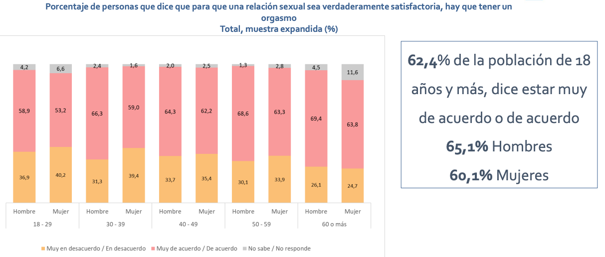

---

# Sexualidad y placer {background-image="C12_01.jpg" background-size="cover" background-opacity="0.35" style="color:white;"}

::: {style="color:#d4b8f5; font-size:1.1em; margin-top:0.5em;"}
SOL191 · Clase 12: Sexualidad y placer
:::

::: notes
Clase de 70 minutos. Distribución sugerida: pregunta inicial 0:00–0:08 · teoría 0:08–0:23 · datos 0:23–0:38 · actividad "¿Mito o dato?" 0:38–0:58 · cierre 0:58–0:68 · 2 min de margen.
:::

---

## ¿Qué aprendiste sobre el placer?

::: {.cuadro-actividad}
**Pregunta anónima (Wooclap):** En tu educación sexual, ¿qué te enseñaron sobre el placer?

Piensa en el colegio, la familia, tus pares y las redes.
:::

::: notes
5 min para responder y 3 min para comentar la nube de palabras. Mirar qué aparece (riesgo, reproducción, prevención) y qué no (deseo, placer). Volver a esto en el cierre.
:::

---

## Sexualidad como construcción social

::: {style="font-size:0.9em;"}
*(Benavente y Vergara 2006)*

- [Sexualidad como constructo social]{.hl}
- Capacidad física para la excitación sexual y el placer
- Significados personales y socialmente compartidos relacionados con el comportamiento y con la formación de las identidades sexuales y de género
- Representación e interpretación cultural de funciones naturales ordenadas en relaciones sociales jerárquicas
:::

::: notes
Teoría: 15 min en total (esta diapositiva hasta "Imperativo del coito"). Ir rápido: 3 min.
:::

---

## Cuerpo para sí, cuerpo para otro

::: {style="font-size:0.78em;"}
*(Benavente y Vergara 2006)*

::: columns
::: {.column width="50%"}
::: {.cuadro-datos}
**Hombres: [cuerpo para sí]{.hl}**

- Ejercer la sexualidad reafirma la hombría
- Sexualidad sin control como parte de la identidad de género
- Que adquieran experiencia
- Excitación física como algo natural
- Placer como parte de sus vidas
:::
:::
::: {.column width="50%"}
::: {.cuadro-datos}
**Mujeres: [cuerpo para otro]{.hl}**

- Discurso centrado en la menstruación y el cuidado del cuerpo
- Secreto y falta de información; menstruación como inicio del riesgo
- Temor y vergüenza del cuerpo sexuado
- Lo masculino como sujeto de placer (activo) y lo femenino como objeto de placer
:::
:::
:::
:::

---

## Guiones sexuales

::: {style="font-size:0.85em;"}
*(Gagnon y Simon 1973)*

::: {.cuadro-datos}
La sexualidad se aprende como un **guion**: no es un impulso "natural" que se expresa solo, sino conductas que adquieren sentido según libretos sociales.
:::

Tres niveles:

- **Escenarios culturales:** qué es "normal", deseable o vergonzoso (medios, escuela, religión)
- **Guiones interpersonales:** quién propone, quién responde, qué "cuenta" como sexo en una interacción
- **Guiones intrapsíquicos:** lo que cada persona desea y se permite desear

[¿Qué guion te enseñaron para hombres y qué guion para mujeres?]{.hl}
:::

---

## El imperativo del coito

::: {style="font-size:0.78em;"}
*(McPhillips, Braun y Gavey 2001)*

- Hetero- y mono-normativas: supuesto de heterosexualidad y monogamia.
- El [imperativo del coito]{.hl}: "sexo de verdad" es penetración pene-vagina
  - Asume heterosexualidad
  - La dificultad o falta de deseo de penetración se lee como "disfunción"
  - Como los hombres suelen tener orgasmo con la penetración y las mujeres muchas veces no, el guion prioriza el orgasmo masculino
- Los guiones definen roles masculinos (asertivo, toma la iniciativa) y femeninos (receptivo, paciente, responde a la iniciativa de él).
:::

::: notes
Esto, junto con otras normas, puede producir la "brecha del orgasmo" en relaciones heterosexuales. Todo lo demás "no cuenta".
:::

---

## Placer sexual en Chile: ENSSEX 2022–2023

::: {style="font-size:0.78em;"}
::: columns
::: {.column width="45%"}
::: {.cuadro-datos}
**ENSSEX** (MINSAL, muestra de 20.392 personas de 18 años y más)

Bienestar con la vida sexual (escala 1–7):

- Hombres: **5,3**
- Mujeres: **4,8**

Mediana de edad de inicio sexual: **17 años**
:::
:::
::: {.column width="52%"}
{fig-align="center"}
:::
:::
:::

::: notes
Datos: 15 min en total (ENSSEX, Frederick, Armstrong). Pregunta: ¿qué significa que el 62,4% (65,1% hombres, 60,1% mujeres) crea que para una relación sexual satisfactoria "hay que tener un orgasmo"? Es una norma y no un dato biológico.

VERIFICAR: la versión anterior de esta diapositiva decía 5,08 / 5,35 / 4,83 (nacional / hombres / mujeres). La prensa reporta 5,1 nacional, 5,3 hombres y 4,8 mujeres. Confirmar contra el informe ENSSEX de MINSAL. Se eliminó la encuesta Gleeden (app de infidelidad, 12 mil usuarios, no representativa): si se menciona, usarla como ejemplo de fuente poco confiable.
:::

---

## ¿Es biológica la "brecha del orgasmo"?

::: {style="font-size:0.78em;"}
*(Frederick, St. John, Garcia y Lloyd 2018; muestra nacional de EE.UU., n ≈ 52.600)*

Personas que tienen orgasmo "habitualmente o siempre" en el sexo con pareja:

| Grupo | % |
|:--|:-:|
| Hombres heterosexuales | **95** |
| Hombres gays | 89 |
| Hombres bisexuales | 88 |
| Mujeres lesbianas | 86 |
| Mujeres bisexuales | 66 |
| Mujeres heterosexuales | **65** |

Si la brecha fuera solo biológica, las lesbianas no estarían cerca de los hombres.
:::

---

## Orgasmo y placer en el contexto universitario

::: {style="font-size:0.7em;"}
*(Armstrong, England y Fogarty 2012; encuesta online a estudiantes de 21 universidades de EE.UU. y 85 entrevistas)*

- Hay mayor satisfacción y tasa de orgasmo en relaciones que en encuentros casuales.
- Una mayor variedad de prácticas se asocia a una mayor satisfacción. Las mujeres participan de más prácticas en relaciones que en encuentros casuales y esto explica en parte la brecha entre ambos.
- Hombres y mujeres reportan que los hombres generalmente no se preocupan del placer femenino en los encuentros casuales, pero sí en las relaciones. Las mujeres sí reportan esfuerzos por el placer masculino en encuentros casuales.
- [Doble estándar]{.hl}: el "derecho" al placer se volvió recíproco en las relaciones, pero en encuentros casuales las mujeres no parecen tener el mismo derecho que los hombres.
:::

---

## Actividad: ¿Mito o dato?

::: {style="font-size:0.78em;"}
::: {.cuadro-actividad}
**En grupos (20 min: 12 de trabajo y 8 de plenario).** Cada grupo recibe un mito. Respondan con evidencia de las lecturas y de la clase:

1. ¿Es mito o dato? ¿Qué evidencia lo respalda o lo contradice?
2. ¿Qué lo sostiene socialmente?
3. ¿A quién beneficia que se siga creyendo?
:::

1. "La brecha del orgasmo es biológica."
2. "La brecha es igual en todas partes."
3. "Las mujeres tienen menos deseo sexual."
4. "El sexo 'de verdad' es penetración."
5. "La liberación sexual ya ocurrió."
6. "Hablar de placer en la escuela sexualiza."
:::

::: notes
Asignar los mitos 1 a 6 entre los 12 grupos (dos grupos por mito, para comparar en el plenario). Las diapositivas siguientes son un banco de evidencia que pueden consultar los grupos y que sirve para el plenario.

Pistas por mito: 1 → Frederick (2018). 2 → Armstrong et al. (2012) y Mahar, Mintz y Akers (2020): las cifras cambian según el contexto y la formulación de la encuesta. 3 → Benavente y Vergara (2006), cuerpo para otro y cap. II pp. 70–84: el deseo depende del cansancio, la crianza y la precariedad. 4 → McPhillips et al. (2001) y ENSSEX (62,4%). 5 → Gill (2008) y Fahs (2014). 6 → Fine y McClelland (2006).

Mitos de reserva si un grupo termina antes: "La satisfacción sexual mide lo mismo para todas las personas" (McClelland 2010) y "El orgasmo de ella es de ella" (Chadwick y van Anders 2017).
:::

---

## Evidencia 1: justicia íntima y orgasmo

::: {style="font-size:0.75em;"}
::: columns
::: {.column width="50%"}
::: {.cuadro-datos}
**Justicia íntima** *(McClelland 2010)*

La satisfacción que declaran las personas es una mala medida de igualdad: lo que sentimos que "merecemos" depende de nuestra posición social. Las mujeres suelen evaluar con umbrales más bajos ("que no duela", "que él esté bien").
:::
:::
::: {.column width="50%"}
::: {.cuadro-datos}
**Fingir el orgasmo**

- *Jackson y Scott (2007):* fingir se entiende como parte del trabajo emocional dentro de la heterosexualidad normativa.
- *Chadwick y van Anders (2017, 810 hombres):* el orgasmo de la pareja funciona como un logro de masculinidad para ellos. Ayuda a entender por qué ellas fingen.
:::
:::
:::
:::

---

## Evidencia 2: deseo y educación sexual

::: {style="font-size:0.72em;"}
::: columns
::: {.column width="50%"}
::: {.cuadro-datos}
**El discurso ausente del deseo** *(Fine 1988; Fine y McClelland 2006)*

La educación sexual enseña a las niñas sobre peligro, riesgo y reproducción, y casi nunca sobre deseo. Proponen un deseo *thick* ("denso"): el deseo se enseña en su contexto social, con derechos y sin ignorar la desigualdad.
:::
:::
::: {.column width="50%"}
::: {.cuadro-datos}
**Jóvenes chilenos y mexicanos** *(Contreras y Silva-Segovia 2018)*

Con jóvenes de 15 a 19 años (Antofagasta y Ocotlán) identifican cinco posiciones: esencialista, sexista, mercantilista, romántica y contrasexual.
:::
:::
:::

::: {.cuadro-datos}
**Placer y clase en Chile** *(Benavente y Vergara 2006, cap. II, pp. 70–84)*: para las mujeres de clase media el placer "no les pertenece completamente" y queda ligado al amor y a la relación; en las parejas jóvenes de sectores populares es central.
:::
:::

---

## Evidencia 3: ¿ya nos liberamos?

::: {style="font-size:0.75em;"}
::: columns
::: {.column width="50%"}
::: {.cuadro-datos}
**Sujeto sexual posfeminista** *(Gill 2008)*

La agencia sexual aparece como "elección" individual, pero sigue ajustada a un modelo de cuerpo y de deseo que ya estaba definido.
:::
:::
::: {.column width="50%"}
::: {.cuadro-datos}
**"Libertad para" y "libertad de"** *(Fahs 2014)*

La política sexo-positiva puede volverse una norma más: "tener que disfrutar" también presiona.
:::
:::
:::

::: {.cuadro-datos}
**Proyectos y geografías sexuales** *(Hirsch y Khan 2020)*: para entender el sexo hay que ver qué buscan las personas (proyectos sexuales) y en qué espacios y relaciones de poder ocurre (geografías sexuales).
:::
:::

---

## Cierre: justicia íntima y educación sexual

::: {style="font-size:0.9em;"}
::: {.cuadro-actividad}
Volvamos a la pregunta inicial.

- ¿Qué cambiaría si el placer fuera parte de la educación sexual integral?
- ¿Qué tendría que ser distinto para que "estar satisfecha" no signifique "que no duela" o "que él esté bien"?
:::
:::

::: notes
10 min. VERIFICAR antes de la clase el estado del proyecto de educación sexual integral: según la revisión, la Cámara lo rechazó en 2020 (73 votos a favor; faltaban 89) y el gobierno le puso urgencia simple en enero de 2026. Confirmar cómo está hoy.

Avisar lo que viene: las defensas orales de esta sesión (Pod 1) y que la ficha de cierre se completa en Wooclap.
:::

---

## Documentales recomendados

::: columns
::: {.column width="50%"}
{fig-align="center"}
:::
::: {.column width="50%"}
{fig-align="center"}
:::
:::

::: notes
Opcional: video "La brecha del orgasmo" (https://www.youtube.com/watch?v=H6DnmEFrIos). Se quitó del flujo principal por el tiempo (70 min); puede recomendarse para después.
:::
