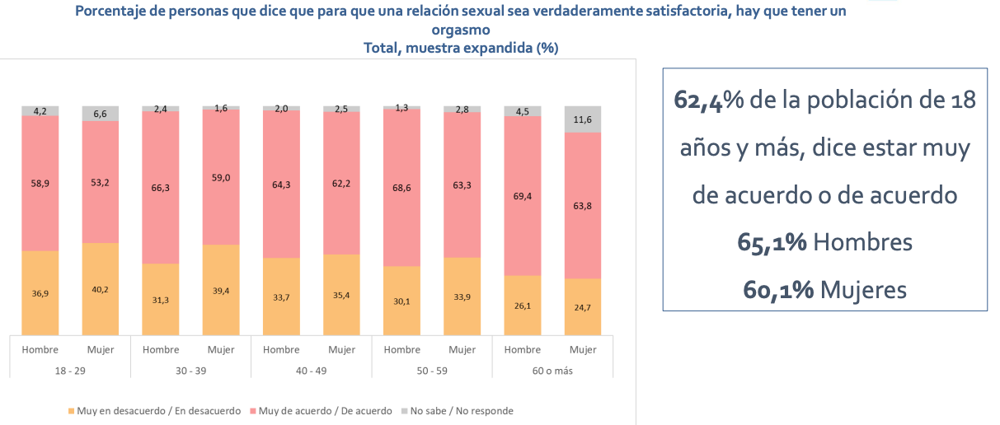

---

# Sexualidad y placer {background-image="C12_01.jpg" background-size="cover" background-opacity="0.35" style="color:white;"}

::: {style="color:#d4b8f5; font-size:1.1em; margin-top:0.5em;"}
SOL191 · Clase 12: Sexualidad y placer
:::

---

## ¿Qué aprendiste sobre el placer?

::: {.cuadro-actividad}
**Pregunta anónima (Wooclap):** En tu educación sexual, ¿qué te enseñaron sobre el placer?

Piensa en el colegio, la familia, tus pares y las redes.
:::

---

## Sexualidad como construcción social

::: {style="font-size:0.9em;"}
*(Benavente y Vergara 2006)*

- [Sexualidad como constructo social]{.hl}
- Capacidad física para la excitación sexual y el placer
- Significados personales y socialmente compartidos relacionados con el comportamiento y con la formación de las identidades sexuales y de género
- Representación e interpretación cultural de funciones naturales ordenadas en relaciones sociales jerárquicas
:::

---

## Cuerpo para sí, cuerpo para otro

::: {style="font-size:0.78em;"}
*(Benavente y Vergara 2006, cap. I, pp. 40–45)*

::: columns
::: {.column width="50%"}
::: {.cuadro-datos}
**Hombres: [cuerpo para sí]{.hl}**

- Ejercer la sexualidad reafirma la hombría
- Sexualidad sin control como parte de la identidad de género
- Que adquieran experiencia
- Excitación física como algo natural
- Placer como parte de sus vidas
:::
:::
::: {.column width="50%"}
::: {.cuadro-datos}
**Mujeres: [cuerpo para otro]{.hl}**

- Discurso centrado en la menstruación y el cuidado del cuerpo
- Secreto y falta de información; menstruación como inicio del riesgo
- Temor y vergüenza del cuerpo sexuado
- Lo masculino como sujeto de placer (activo) y lo femenino como objeto de placer
:::
:::
:::
:::

---

## Guiones sexuales

::: {style="font-size:0.85em;"}
*(Gagnon y Simon 1973)*

::: {.cuadro-datos}
La sexualidad se aprende como un **guion**: no es un impulso "natural" que se expresa solo, sino conductas que adquieren sentido según libretos sociales.
:::

Tres niveles:

- **Escenarios culturales:** qué es "normal", deseable o vergonzoso (medios, escuela, religión)
- **Guiones interpersonales:** quién propone, quién responde, qué "cuenta" como sexo en una interacción
- **Guiones intrapsíquicos:** lo que cada persona desea y se permite desear

[¿Qué guion te enseñaron para hombres y qué guion para mujeres?]{.hl}
:::

---

## El imperativo del coito

::: {style="font-size:0.78em;"}
*(McPhillips, Braun y Gavey 2001)*

- Hetero- y mono-normativas: supuesto de heterosexualidad y monogamia.
- El [imperativo del coito]{.hl}: "sexo de verdad" es penetración pene-vagina
  - Asume heterosexualidad
  - La dificultad o falta de deseo de penetración se lee como "disfunción"
  - Como los hombres suelen tener orgasmo con la penetración y las mujeres muchas veces no, el guion prioriza el orgasmo masculino
- Los guiones definen roles masculinos (asertivo, toma la iniciativa) y femeninos (receptivo, paciente, responde a la iniciativa de él).
:::

---

## Placer sexual en Chile: ENSSEX 2022–2023

::: {style="font-size:0.78em;"}
::: columns
::: {.column width="45%"}
::: {.cuadro-datos}
**ENSSEX** (MINSAL, muestra de 20.392 personas de 18 años y más)

Bienestar con la vida sexual (escala 1–7):

- Hombres: **5,3**
- Mujeres: **4,8**

Mediana de edad de inicio sexual: **17 años**
:::
:::
::: {.column width="52%"}
{fig-align="center"}
:::
:::
:::

---

## ¿Es biológica la "brecha del orgasmo"?

::: {style="font-size:0.78em;"}
*(Frederick, St. John, Garcia y Lloyd 2018; encuesta online anónima en el sitio de NBC News, N = 52.588 personas adultas de EE.UU.; muestra **no representativa**)*

Personas que tienen orgasmo "habitualmente o siempre" en el sexo con pareja:

| Grupo | % |
|:--|:-:|
| Hombres heterosexuales | **95** |
| Hombres gays | 89 |
| Hombres bisexuales | 88 |
| Mujeres lesbianas | 86 |
| Mujeres bisexuales | 66 |
| Mujeres heterosexuales | **65** |

Si la brecha fuera solo biológica, las lesbianas no estarían cerca de los hombres.
:::

---

## Orgasmo y placer en el contexto universitario

::: {style="font-size:0.7em;"}
*(Armstrong, England y Fogarty 2012; datos de las **mujeres** que respondieron una encuesta online en 21 universidades de EE.UU., más 85 entrevistas en dos universidades)*

- Las mujeres reportan más orgasmo y disfrute sexual en relaciones que en encuentros casuales.
- Parte de esa diferencia se explica porque en las relaciones hay más **prácticas que favorecen el orgasmo femenino**.
- En las entrevistas, hombres y mujeres describen a los hombres como poco atentos al placer femenino en los encuentros casuales y más atentos en las relaciones.
- [Doble estándar]{.hl} *(entrevistas)*: hombres y mujeres cuestionan el derecho de las mujeres al placer en encuentros casuales, pero no el de los hombres.
:::

---

## Actividad: Discusión

::: {style="font-size:0.78em;"}
::: {.cuadro-actividad}
**En grupos (20 min: 12 de trabajo y 8 de plenario).** Cada grupo recibe una afirmación. Respondan con evidencia de las lecturas y de la clase:

1. ¿Es mito o dato? ¿Qué evidencia lo respalda o lo contradice?
2. ¿Qué lo sostiene socialmente?
3. ¿A quién beneficia que se siga creyendo?
:::

1. "Las mujeres tienen menos orgasmos porque su cuerpo es más complicado."
2. "Si hombres y mujeres dicen estar igual de satisfechos, no hay desigualdad."
3. "En los encuentros casuales ellas disfrutan menos porque necesitan amor para disfrutar."
4. "El bajo deseo de las mujeres es un rasgo, no una circunstancia."
5. "La educación sexual debe enseñar riesgo de salud y reproducción; el consentimiento y el placer es asunto de cada familia."
:::

---

## Evidencia 1: justicia íntima y orgasmo

::: {style="font-size:0.75em;"}
::: columns
::: {.column width="50%"}
::: {.cuadro-datos}
**Justicia íntima** *(McClelland 2010, 2014)*
 Incorporar el "derecho" y el merecimiento al estudiar la satisfacción sexual: lo que sentimos que "merecemos" depende de nuestra posición social, así que la satisfacción declarada no basta para medir igualdad. 
 En su trabajo empírico, las mujeres asociaban el extremo bajo de la escala con **dolor**; los hombres, con no tener sexo. Las mujeres también califican alto cuando su pareja está satisfecha.
:::
:::
::: {.column width="50%"}
::: {.cuadro-datos}
**Fingir el orgasmo**

- *Jackson y Scott (2007):* el placer y el orgasmo son una **performance interactiva e interpretativa**: "leer" a la pareja y producir una actuación calibrada. La presión a fingir se entiende como parte del trabajo emocional de mantener una relación heterosexual.
- *Chadwick y van Anders (2017):* experimento con viñetas; 810 hombres imaginaron al azar que una mujer tenía o no un orgasmo con ellos: Cuando lo tenía funciona como logro de masculinidad. Podría explicar por qué algunas mujeres fingen.
:::
:::
:::
:::

---

## Deseo y educación sexual

::: {style="font-size:0.72em;"}
::: columns
::: {.cuadro-datos}
**El discurso ausente del deseo** *(Fine 1988; Fine y McClelland 2006)*

La educación sexual enseña a las niñas sobre peligro, riesgo y reproducción, y casi nunca sobre deseo. Proponen que el deseo se enseñe en su contexto social, con derechos y sin ignorar la desigualdad.
:::
:::
:::

---

## Cierre: justicia íntima y educación sexual

::: {style="font-size:0.9em;"}
::: {.cuadro-actividad}
Volvamos a la pregunta inicial.

- ¿Qué cambiaría si el placer fuera parte de la educación sexual integral?
- ¿Qué tendría que ser distinto para que "estar satisfecha" no signifique "que no duela" o "que él esté bien"?
:::
:::

---

## Documentales recomendados

::: columns
::: {.column width="50%"}
{fig-align="center"}
:::
::: {.column width="50%"}
{fig-align="center"}
:::
:::

