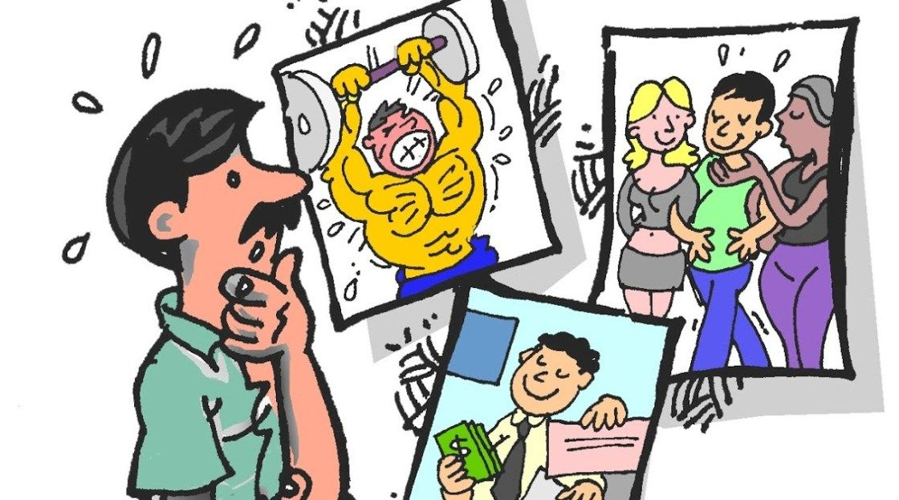
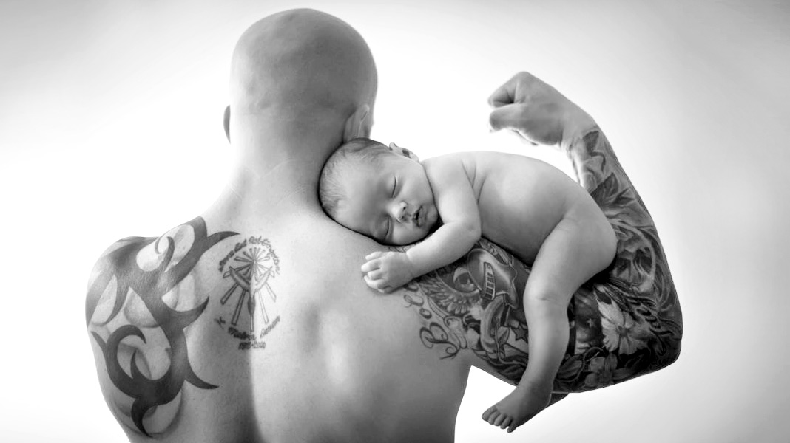
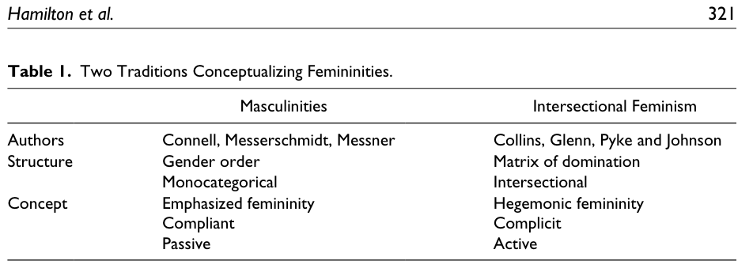
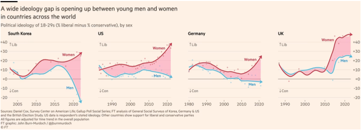

---

# Feminidades y Masculinidades {background-image="C8_01.jpg" background-size="cover" background-opacity="0.35" style="color:white;"}

::: {style="color:#d4b8f5; font-size:1.1em; margin-top:0.5em;"}
SOL191 · Clase 8: Feminidades y Masculinidades
:::

---

## Objetivos de hoy

::: {style="font-size:0.95em;"}
- Revisar y evaluar diferentes definiciones teóricas de los conceptos de feminidades y masculinidades: masculinidad hegemónica, feminidad enfatizada, masculinidades híbrido y feminidades hegemónicas.
- Aplicar estos conceptos con ejemplos de estudios empíricos recientes.
- Analizar la "manosfera" como fenómeno contemporáneo y su relación con las crisis de masculinidad.
- Examinar la divergencia ideológica de género entre jóvenes en América Latina.
:::

---

## Wooclap: ¿Qué tan de acuerdo estás? {background-color="#f8f4ff"}

::: {style="font-size:1.1em; text-align:center; margin-top:1em;"}
*"Ser hombre hoy es más difícil que en el pasado"*

:::

---

## Masculinidad hegemónica (según R. Connell)

::: {style="font-size:0.82em;"}
::: columns
::: {.column width="70%"}
- Vivimos en una sociedad que es "patriarcal". Los hombres, como grupo, tienen poder sobre las mujeres, como grupo.
- Sin embargo, no todos los hombres están en el poder o se sienten poderosos. La masculinidad tiene su propia jerarquía.
- La [masculinidad hegemónica]{.hl} es la forma de masculinidad más dominante y poderosa. Otros tipos de masculinidad incluyen la masculinidad gay o masculinidades racializadas (masculinidades subordinadas).
:::
:::
:::

---

## Masculinidad hegemónica (R. Connell)

::: {style="font-size:0.8em;"}
::: columns
::: {.column width="50%"}
- La masculinidad hegemónica ([MH]{.hl}) es dominante sobre las masculinidades y feminidades subordinadas.
- MH es un tipo ideal o una fantasía que muy pocos hombres encarnan, pero que muchos luchan por alcanzar.
- El contenido varía en el tiempo y el espacio, pero actualmente en la sociedad occidental tiende a ser un hombre heterosexual, blanco, educado, rico y fuerte.
- El contenido es menos importante que la posición en la jerarquía. El contenido puede ir modificándose, como veremos en esta clase.
:::
::: {.column width="48%"}
{fig-align="center"}
:::
:::
:::

---

## Repensando la MH: bloque híbrido y niveles (Connell y Messerschmidt 2005)

::: {style="font-size:0.78em;"}
::: columns
::: {.column width="50%"}
::: {.cuadro-datos}
**Bloque híbrido** (Demetriou 2001)

- La MH no es un patrón puro: se apropia de lo que le sea útil de masculinidades subordinadas y marginadas ("hegemonía interna").
- El resultado es un *bloque hegemónico* híbrido, capaz de reconfigurarse ante nuevas coyunturas históricas.
- Connell y Messerschmidt aceptan parte de la crítica, pero dudan que esa hibridación sea hegemónica más allá de lo **local**.
:::
:::
::: {.column width="48%"}
::: {.cuadro-datos}
**Tres niveles**

- **Local**: familias, organizaciones, comunidades
- **Regional**: cultura o Estado-nación
- **Global**: política mundial, negocios y medios transnacionales

Los niveles se influyen mutuamente; el nivel global no determina mecánicamente al regional ni al local.
:::
:::
:::

**Pregunta:** si la hegemonía siempre fue híbrida, ¿qué es lo que realmente cambia en "la masculinidad está cambiando"?
:::

---

## Video y discusión sobre masculinidades

¿Cómo aprenden los hombres qué emociones pueden expresar? 

¿Qué sanciones sociales enfrentan cuando se alejan del ideal del «hombre de verdad»? 

¿Basta con un cambio individual para transformar esas normas?

## Feminidad enfatizada (R. Connell)

::: {style="font-size:0.85em;"}
- No existe ninguna forma de feminidad que sea dominante. Más bien, las formas de feminidad son respuestas al dominio masculino.
- La [feminidad enfatizada]{.hl} (FE), la forma más visible de feminidad, se organiza en torno al cumplimiento de la dominación masculina.
- Las FE incluyen rasgos y conductas que muestran dependencia de los hombres. ¿Ejemplos?
:::

---

## Crisis de masculinidad (Bridges y Pascoe 2018)

::: {style="font-size:0.82em;"}
- Connell dice que las relaciones de género son históricamente inestables y tienden a entrar en crisis. Estas crisis afectan las relaciones de género de manera incompleta.
- Se han intensificado en la historia reciente, resultando en "una gran pérdida de legitimidad del patriarcado" y "diferentes grupos de hombres están negociando esta pérdida en formas muy diferentes".
- Los periodos de cambio pueden venir con un [vértigo de género]{.hl}, un sentido de malestar e incomodidad en la medida que las estructuras y relaciones de género se van transformando.
- Esta crisis no es "de" la masculinidad sino de las relaciones de género: el marco hegemónico pierde legitimidad pero no ha sido reemplazado.
:::

---

# La manosfera y las masculinidades online {background-color="#6B4C9A" style="color:white;"}

---

## La "crisis de conexión" masculina (Equimundo 2024)

::: {style="font-size:0.82em;"}
::: columns
::: {.column width="50%"}
::: {.cuadro-datos}
**Datos del informe *State of American Men 2023***

- [48%]{.hl} de hombres jóvenes (18-23) dice que su vida online es más interesante que la offline.
- [2/3]{.hl} de hombres jóvenes sienten que "nadie los conoce realmente".
- [40%]{.hl} de los hombres confían en una o más voces misóginas online.
- [44%]{.hl} de hombres reportó pensamientos suicidas en las últimas dos semanas.
:::
:::
::: {.column width="48%"}
- Hombres jóvenes enfrentan una combinación de soledad, confusión sobre qué significa "ser hombre", inestabilidad económica y dificultades en relaciones.
- La manosfera ofrece respuestas simples a problemas complejos: roles claros, comunidad, sentido de propósito.
- [53%]{.hl} de los hombres cree que "hoy en día los hombres la tienen más difícil que las mujeres".
:::
:::
:::

---

## ¿Qué es la manosfera?

::: {style="font-size:0.82em;"}
::: columns
::: {.column width="55%"}
Una colección diversa de sitios web, blogs y foros online que promueven la masculinidad, la misoginia y la oposición al feminismo. Incluye:

- **MRAs** (Men's Rights Activists): activistas por "derechos de los hombres"
- **MGTOW** (Men Going Their Own Way): hombres que rechazan relaciones con mujeres
- **PUAs** (Pick-Up Artists): artistas de la seducción
- **TradCons**: conservadores tradicionalistas
- **Incels**: célibes involuntarios
:::
::: {.column width="43%"}
::: {.cuadro-datos}
**La "cadena" de la manosfera** (Bates)

Los contenidos se mueven de los grupos más extremos hacia el mainstream, ganando un "barniz de normalización" en el camino. Cada comunidad interactúa con las adyacentes, manteniendo la movilidad de ideas pero aislando los eslabones más altos de la censura pública.
:::
:::
:::
:::

---

## La fórmula de la manosfera

::: {style="font-size:0.82em;"}
::: columns
::: {.column width="32%"}
::: {.cuadro-datos}
**1. Validación emocional**

Explotan la inseguridad masculina. Culpan a otros (feminismo, sociedad) y canalizan el resentimiento.

*"Me enseñaron a ser femenino, pero las mujeres rechazan al nice guy"*
:::
:::
::: {.column width="32%"}
::: {.cuadro-datos}
**2. Aspiraciones**

Ofrecen modelos claros y un camino paso a paso: fitness, dinero, éxito sexual.

*Escuelas online con suscripción ($199/mes) sobre "productividad" y "energía masculina"*
:::
:::
::: {.column width="32%"}
::: {.cuadro-datos}
**3. Comunidad**

Ofrecen pertenencia y accountability grupal. Métricas de progreso. Identidad compartida.

*Grupos activos en redes sociales y membresías pagadas*
:::
:::
:::
:::

---

## Discusión en grupo

::: {.cuadro-actividad}
- ¿Cómo se podría responder a la "crisis de conexión" masculina sin reforzar la misoginia?
- ¿La manosfera crea el resentimiento o lo capta y lo monetiza? ¿Qué implica cada respuesta para posibles intervenciones?
:::

---

## Masculinidades híbrido (Bridges y Pascoe 2018)

::: {style="font-size:0.85em;"}
::: columns
::: {.column width="48%"}
{fig-align="center"}
:::
::: {.column width="48%"}
- La masculinidad está cambiando. Pero si la MH fue siempre un bloque híbrido (Demetriou 2001), ¿cambia el mecanismo o solo los elementos que se incorporan?
- [Masculinidades híbrido]{.hl}: la incorporación selectiva de elementos de identidad típicamente asociados con diversas masculinidades o feminidades marginadas y subordinadas en las expresiones e identidades de género de los hombres privilegiados.
- ¿Qué ejemplos de masculinidades híbrido dan en este artículo?
:::
:::
:::

---

## Consecuencias de las masculinidades híbrido

::: {style="font-size:0.78em;"}
::: columns
::: {.column width="48%"}
**Distancia discursiva**

- Hombres privilegiados se enmarcan fuera de la MH ("yo no soy machista") sin renunciar a sus beneficios. El "machismo" se atribuye a hombres desaventajados.

**Préstamo estratégico**

- Apropiación lúdica de elementos de masculinidades subordinadas ("turismo simbólico"): disfrutar la transgresión sin pagar el costo.
- Ejemplo: hombre metrosexual que toma prestada la cultura gay.
:::
::: {.column width="48%"}
**Fortaleciendo límites**

- Estos cambios fortalecen límites simbólicos entre grupos, escondiendo la desigualdad en formas novedosas.
- El "bromance" permite cercanía emocional entre hombres solo bajo la condición de que la heterosexualidad no se cuestione.

{fig-align="center"}
:::
:::

En conjunto: el cambio en las masculinidades puede servir para **modernizar** la hegemonía, no para eliminarla.
:::

---

## Feminidad hegemónica según Schippers (2007)

::: {style="font-size:0.82em;"}
::: columns
::: {.column width="50%"}
::: {.cuadro-datos}
**Schippers (2007)**

- La feminidad hegemónica se define por su relación **complementaria y jerárquica** con la MH.
- Se sostiene conteniendo a las **feminidades parias**: feminidades no conformes que amenazan la relación entre MH y feminidad.
:::
:::
::: {.column width="48%"}
::: {.cuadro-datos}
**Hamilton et al. (2019)**

- La feminidad hegemónica se define por la **dominación interseccional** de unas mujeres sobre otras (raza, clase, sexualidad).
:::
:::
:::

**Dos usos de la misma etiqueta:** en Schippers, la feminidad hegemónica se define en relación con los hombres; en Hamilton et al., en relación con otras mujeres.
:::

---

## Video y discusión

¿Cómo se relacionan las expectativas presentadas en el video con la reproducción de desigualdades de género?

¿De qué manera las actrices deben demostrar que son suficientemente femeninas para obtener el papel?

---

## Feminidades (Hamilton et al. 2019)

::: {style="font-size:0.78em;"}
Cómo dos tradiciones sociológicas explican el rol de las feminidades en la dominación social

::: columns
::: {.column width="58%"}
**Connell y otros — Masculinidades**

- Género como estructura de dominación independiente
- Feminidades complementan las masculinidades hegemónicas: cómplices pasivas en la reproducción de género.
- Feminidades enfatizadas: pasivo y mono categórico.

**Hill Collins y otros — Dominación interseccional**

- Ideas culturales de feminidad reproducen una matriz de dominación: ideas culturales de feminidad son racializadas, hetero-generizadas, de clase, etc.
- Todas las feminidades pueden ser subordinadas a las masculinidades hegemónicas, pero algunas feminidades juegan un rol poderoso en reproducir otras formas de desigualdad: [dominación interseccional]{.hl}.
:::
::: {.column width="40%"}
{fig-align="center"}
:::
:::
:::

---

{fig-align="center" width="85%"}

---

## Feminidades hegemónicas

::: {style="font-size:0.85em;"}
::: {.cuadro-datos}
Ideales culturales de feminidad más celebrados en un momento y lugar determinados y que sirven para defender y legitimar todos los ejes de opresión en la matriz de dominación simultáneamente.

— Collins
:::

::: {.cuadro-actividad}
Las feminidades hegemónicas pueden recibir ciertos "bonos" o "premios". ¿Ejemplos?
:::
:::

---

## Masculinidades hegemónicas en la clase dominante (Madrid 2016)

::: {style="font-size:0.82em;"}
Estudia el proceso de construcción de masculinidades hegemónicas en la clase dominante chilena.

::: {.cuadro-actividad}
- ¿Qué hizo el autor en este estudio?
- ¿Cuáles son los tres tipos de colegios que identificó?
- ¿Cuáles son los principales resultados?
- ¿Cómo se podrían relacionar estos resultados con los conceptos de masculinidad hegemónica, masculinidades híbridas y masculinidades con perspectiva interseccional?
- Madrid no habla de las feminidades, menos de las feminidades hegemónicas y su relación con la clase social. ¿Cuál creen que es el rol de las feminidades en este estudio?
:::
:::

---

# Divergencia ideológica de género {background-color="#6B4C9A" style="color:white;"}

::: {style="font-size:0.9em; color: white;"}
¿Se están separando políticamente los hombres y mujeres jóvenes?
:::

---

## Una nueva brecha global de género (Burn-Murdoch 2024)

{fig-align="center" width="90%"}

---

## Divergencia ideológica en América Latina (Argote 2026)

::: {style="font-size:0.78em;"}
::: columns
::: {.column width="55%"}
**Datos y método**

- LAPOP AmericasBarometer (2006-2023)
- 6 países: Argentina, Brasil, Chile, Colombia, México, Uruguay
- 71.228 observaciones
- Análisis por cohorte de nacimiento

**Hallazgo central**

Existe una clara [brecha ideológica de género]{.hl} entre los jóvenes: mujeres nacidas después de 1980 se inclinan a la izquierda y hombres a la derecha. Esta divergencia está ausente en generaciones anteriores.
:::
::: {.column width="43%"}
::: {.cuadro-datos}
**El puzzle**

La brecha se da en las *etiquetas* ideológicas (izquierda-derecha) pero **no** en posiciones sustantivas. No hay divergencia en:

- Apoyo a reducir desigualdad
- Matrimonio igualitario
- Aborto

Las tendencias en estos temas son paralelas entre géneros.
:::
:::
:::
:::

---

## ¿Qué miden las "posiciones sustantivas"?

::: {style="font-size:0.78em;"}
::: columns
::: {.column width="48%"}
::: {.cuadro-datos}
**Lo que mide Argote (2026)**

- Redistribución
- Matrimonio igualitario
- Aborto

Ninguno mide **roles de género en la familia o el trabajo**, que es donde la literatura ubica el estancamiento.
:::
:::
::: {.column width="48%"}
::: {.cuadro-datos}
**Lo que muestra la literatura**

- **Cotter, Hermsen y Vanneman (2011)**: en EEUU las actitudes de rol de género dejan de liberalizarse desde mediados de los 90. Lo explican por un "esencialismo igualitario".
- **Knight y Brinton (2017)**: no hay un solo continuo tradicional-igualitario; hay igualitarismo liberal, familista y flexible.
- **Scarborough, Sin y Risman (2019)**: la ambivalencia como categoría propia.
- **England (2010)**: cambio asimétrico, las mujeres entran a lo masculino y no al revés.
:::
:::
:::

**Implicancia:** que no haya divergencia en esos tres temas no descarta divergencia en ideología de género. La "divergencia identitaria" podría ser en parte un efecto de medición.
:::

---

## ¿Qué explica la brecha? (Argote 2026)

::: {style="font-size:0.82em;"}
::: columns
::: {.column width="48%"}
**Lo que NO la explica**

- ❌ Backlash cultural: los hombres jóvenes no son más conservadores en temas sociales que los mayores
- ❌ Educación: la brecha existe tanto en universitarios como en no-universitarios
- ❌ Retroceso económico: el enfriamiento en apoyo a redistribución es generacional y compartido
:::
::: {.column width="48%"}
**Lo que sugiere la evidencia**

- ✓ Efecto de periodo post-2015, concentrado en los hombres
- ✓ Coincide con Ni Una Menos y Marea Verde
- ✓ Los hombres rechazan la *identidad* de izquierda — reaccionan contra lo que esa etiqueta representa
- ✓ [Divergencia identitaria]{.hl}: clasificación en tribus opuestas por apego simbólico, no por desacuerdo en políticas
:::
:::

**¿Identidad *o* condiciones materiales?** Gidron y Hall (2017) proponen un mecanismo intermedio: el estatus social subjetivo. La ansiedad de estatus sería el factor próximo, y los cambios económicos y culturales se combinarían para producirla.
:::

---

## Datos electorales y actitudinales: la brecha se traduce en votos

::: {style="font-size:0.82em;"}
::: columns
::: {.column width="48%"}
::: {.cuadro-datos}
**Elecciones recientes (Argote 2026)**

- **Argentina 2023**: entre 18-25 años, 56% hombres votaron por Milei vs. 34% mujeres (22 puntos de diferencia)
- **Chile 2021**: 68% mujeres sub-30 votaron por Boric. Brecha de participación: 63% mujeres vs. 47% hombres
- **Brasil 2022**: mujeres 16-29 apoyaron a Lula 58% vs. 44% de hombres jóvenes
:::
:::
::: {.column width="48%"}
::: {.cuadro-datos}
**Chile hoy (ICSO-UDP julio 2025)**

- "Ser hombre hoy es más difícil": hombres [54%]{.hl}, mujeres 38%; derecha 60%, izquierda 37%
- "Difícil saber cómo comportarse con mujeres por temor a ser malinterpretado": hombres [68%]{.hl}, mujeres 52%
- **Sin embargo:** 79% apoya avances en derechos de las mujeres, 89% cree importante que hombres expresen emociones, 86% ve positivo postnatal masculino
:::
:::
:::
:::

---

## Actividad en grupo: Brecha de género ideológica en América Latina {background-color="#f8f4ff"}

::: {style="font-size:0.82em;"}
::: {.cuadro-actividad}
**Grupos de 4-5 estudiantes. Revisen el material proporcionado y discutan:**

1. **Hallazgo principal**: Argote (2026) encuentra una "divergencia identitaria" — hombres y mujeres jóvenes se identifican con tribus ideológicas opuestas pero no difieren en posiciones sustantivas (redistribución, matrimonio igualitario, aborto). ¿Cómo interpretan este resultado?

2. **Contexto latinoamericano**: A diferencia de EEUU/Europa, la educación universitaria no explica la brecha. ¿Por qué creen que el efecto de la universidad es diferente en América Latina?

3. **Conexión con masculinidades**: ¿Cómo se relaciona esta divergencia con los conceptos de masculinidad hegemónica, crisis de masculinidad y manosfera que vimos hoy? ¿Es la brecha una manifestación del "vértigo de género" de Bridges y Pascoe?

4. **Experiencia propia**: ¿Observan esta brecha en su generación en Chile? ¿En qué se manifiesta? ¿Qué rol juegan las redes sociales?
:::
:::

---

## Recordatorios
