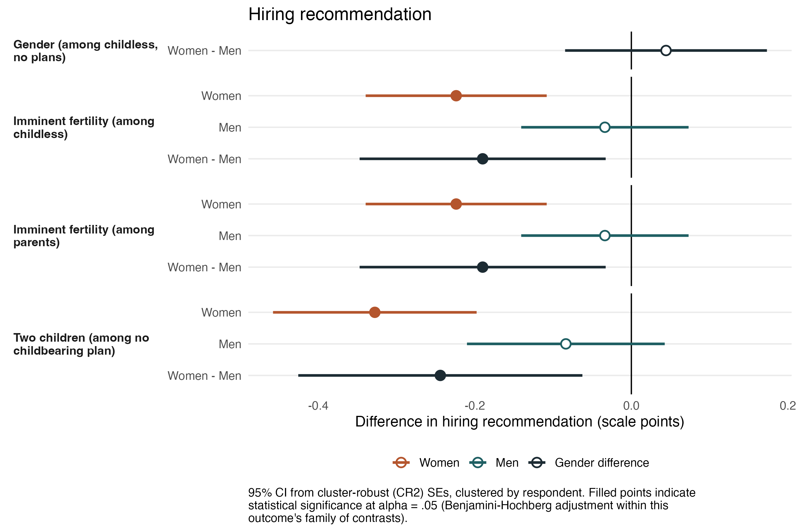
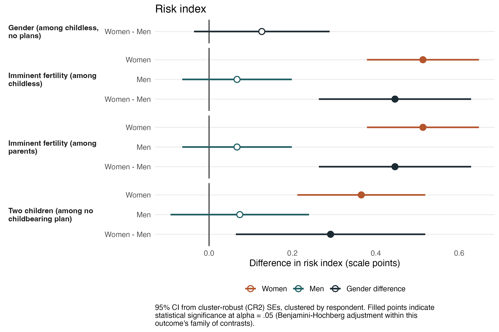
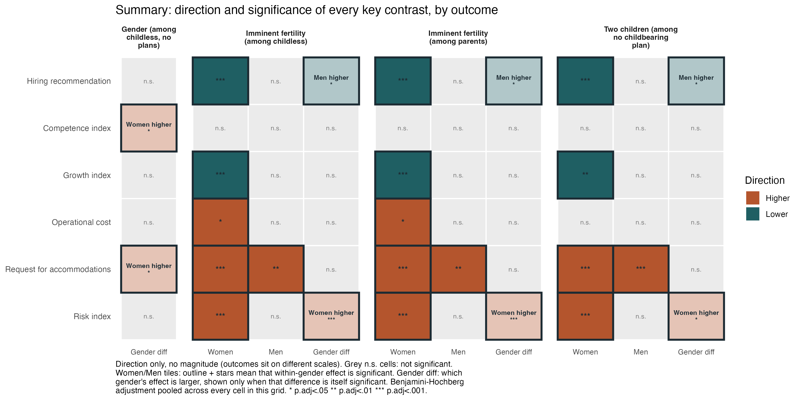

---

# Trabajo remunerado y mercado laboral {background-image="C8C9_01.jpg" background-size="cover" background-opacity="0.35" style="color:white;"}

::: {style="color:#d4b8f5; font-size:1.1em; margin-top:0.5em;"}
SOL191 · Clase 9: Trabajo remunerado y mercado laboral
:::

---

## Objetivos de hoy

::: {style="font-size:0.85em;"}
- Comprender el castigo salarial a la maternidad y sus mecanismos en América Latina.
- Analizar cómo los estereotipos de género operan en procesos de contratación, incluso antes de la maternidad.
- Examinar la brecha salarial de género en Chile: cómo se mide, qué la explica y qué no.
- Discutir cómo la discriminación laboral se intersecta con clase, estado civil, sexualidad y edad.
:::

---

# Trabajo remunerado y mercado laboral {background-color="#6B4C9A" style="color:white;"}

---

## Castigo a la maternidad en salarios en Latinoamérica (Villanueva & Lin 2019)

::: {style="font-size:0.8em;"}
- ¿Qué buscan estudiar en este artículo? ¿Qué encuentran para Chile?
- Castigo a la maternidad en salarios en 5 países: desde 12% en Brasil a [21% en Chile]{.hl} (el más alto).
- La participación de madres en trabajo informal explica parte del castigo a la maternidad.
  - Pero no tanto en Chile: % de informalidad más bajo y la maternidad no es un determinante tan importante del trabajo informal.
  - NOTA: Datos previos a la pandemia; la informalidad laboral femenina aumentó desde entonces.
:::

---

## Más allá de la maternidad actual: la fertilidad anticipada

::: {style="font-size:0.8em;"}
::: columns
::: {.column width="58%"}
- La investigación suele comparar madres vs. no-madres como una dicotomía.
- Pero los empleadores anticipan en quién es probable que se convierta una candidata.
- Las mujeres podrían ser penalizadas por la mera [expectativa de maternidad futura]{.hl}, incluso sin hijos/as.
- La fertilidad anticipada es **prospectiva e inverificable**: un juicio que las mujeres no pueden rebatir.
:::
::: {.column width="40%"}
{fig-align="center"}
:::
:::
:::

::: notes
Esto motiva un estudio experimental que diseñé para Chile: ¿qué estereotipos asocian los empleadores con la fertilidad potencial y la maternidad actual de las postulantes? ¿Los hombres enfrentan penalizaciones similares? A diferencia de estudios previos realizados en EEUU, este se sitúa en un contexto de políticas maternalistas: licencia de maternidad extensa, prácticamente sin licencia de paternidad, y sala cuna vinculada exclusivamente a las trabajadoras.
:::

---

## Estudio experimental en Chile (Hutt, en proceso)

::: {style="font-size:0.78em;"}
::: {.nonincremental}
::: columns
::: {.column width="50%"}
::: {.cuadro-datos}
**Diseño**

- Experimento factorial con [1.449 supervisores/as]{.hl} en Chile
- Evalúan perfiles ficticios de postulantes a una vacante
- Perfiles varían: **género**, estado civil, **situación parental** (0, 1, 2 hijos/as), **planes familiares** (en 2 años / 5 años / no desea), experiencia y desempeño
:::
:::
::: {.column width="48%"}
::: {.cuadro-datos}
**Variables de resultado**

- **Evaluación:** contratación, buena inversión
- **Competencia:** capaz, confiable
- **Crecimiento:** prometedora, ambiciosa, promovida
- **Costo:** costosa, solicita facilidades, usa beneficios
- **Riesgo:** compromiso largo plazo, ausentarse, renunciar
:::
:::
:::
:::
:::

::: notes
Los experimentos conjoint permiten testear causalmente el efecto de cada atributo del perfil, manteniendo constantes todos los demás. La fertilidad potencial fue señalizada mediante el atributo de planes familiares, cruzado con la situación parental. Esto separa la maternidad actual de la fertilidad anticipada como factores experimentales distintos. Las dos ocupaciones (profesional y técnica) no moderan los efectos principales, así que los resultados son de la muestra agrupada. Estudio prerregistrado en AsPredicted.
:::

---

## Antes de ver los resultados... {background-color="#f8f4ff"}

::: {style="font-size:0.9em;"}
::: {.nonincremental}
::: {.cuadro-actividad}
Pensando en el diseño del estudio:

- ¿En qué dimensiones serían penalizadas las mujeres con planes de tener hijos/as en 2 años: costo, riesgo, crecimiento, competencias? ¿En todas?
- ¿Los hombres con los mismos planes serían penalizados de forma similar?
- ¿Esperan diferencias entre mujeres que ya son madres y las que no?
:::
:::
:::

::: notes
3-5 min. Pedir que levanten la mano o respondan por Wooclap. La idea es que hagan predicciones antes de ver los datos. La mayoría predecirá penalizaciones en todas las dimensiones para mujeres — los resultados de competencia los van a sorprender.
:::

---

## Resultados: recomendación de contratación

{fig-align="center" width="78%"}

::: notes
La recomendación de contratación se reduce por fertilidad inminente y por maternidad con dos hijos/as, pero no por género solo ni por un/a primer/a hijo/a. Ambas penalizaciones son específicas de las mujeres. Para los hombres, ni declarar planes inminentes de tener un/a hijo/a ni tener hijos/as modifica la recomendación. Preguntar: ¿les sorprende que género solo no penalice la contratación? ¿Qué dice eso sobre dónde opera realmente la discriminación?
:::

---

## Resultados: índice de riesgo

{fig-align="center" width="78%"}

::: notes
Las mujeres son evaluadas como más riesgosas por fertilidad inminente —con o sin hijos/as— y por maternidad con dos hijos/as. Independientemente de las señales familiares, el riesgo percibido de los hombres es estable. En esta dimensión, cada diferencia de género es estadísticamente significativa. Dato clave: la competencia nunca es penalizada. Los evaluadores no juzgan a estas postulantes como menos capaces o confiables, lo que desafía la explicación clásica basada en estatus de Correll et al. (2007).
:::

---

## Resumen de resultados

{fig-align="center" width="85%"}

::: {style="font-size:0.75em; text-align:center;"}
Solo dirección, no magnitud — las variables de resultado se encuentran en escalas distintas.
:::

::: notes
Recorrer las columnas. Columna 1, género sin señal familiar: casi vacía — sin información familiar no hay brecha en contratación. Columnas 2 y 3, fertilidad inminente entre mujeres sin hijos/as y entre madres: son casi idénticas, ese es el hallazgo — no importa si ya tiene hijos/as. Cada fila se activa excepto competencia. Columna 4, dos hijos/as sin planes de más: misma forma pero sin costo operacional — la maternidad no aumenta el costo percibido, la maternidad anticipada sí. La fila de competencia está vacía en todos los casos. La fila de facilidades es la única donde los hombres también son penalizados. Tres hallazgos clave: (1) género solo no penaliza contratación, (2) fertilidad inminente penaliza por igual a madres y no-madres, (3) maternidad actual solo desde el 2do hijo/a.
:::

---

## La asimetría clave

::: {style="font-size:0.78em;"}
Las señales familiares aumentan el uso esperado de facilidades tanto para **mujeres como para hombres**.

::: {.cuadro-datos}
Pero las consecuencias negativas recaen [exclusivamente sobre las mujeres]{.hl}: más costosas, menor potencial de crecimiento, más riesgosas. En Chile, estas expectativas son reforzadas por políticas que vinculan licencias y beneficios **primordialmente a las madres**.
:::

::: {.cuadro-actividad}
- ¿Qué rol juegan las políticas de licencia parental y sala cuna en esta asimetría? ¿Cambiaría con sala cuna universal o licencia compartida?
- Si la competencia no es penalizada, ¿es más efectivo cambiar percepciones o cambiar las políticas?
:::
:::

::: notes
Esta es la forma más precisa de enunciar el resultado de género: no es que los empleadores no noten que los hombres tienen familias, sino que solo para las mujeres una demanda anticipada se convierte en costo, riesgo y menor potencial. Las políticas maternalistas chilenas refuerzan esto: sala cuna vinculada a trabajadoras (no a trabajadores), licencia parental de 5 días para padres (vs. 6 meses para madres), y entre 2011-2016 solo el 0,24% de los hombres elegibles usó el postnatal parental. La discusión sobre sala cuna universal y postnatal compartido es particularmente relevante porque conecta directamente con debates de política pública actuales en Chile.
:::

---

## Discriminación en contrataciones en Chile (Undurraga 2019)

::: {style="font-size:0.8em;"}
Estudio cualitativo con reclutadores y empleadores en Santiago sobre cómo operan los criterios de selección y qué sesgos se activan en la contratación.

::: {.cuadro-actividad}
A partir de la lectura:

- ¿Cuáles son los principales resultados en cada eje: género, clase, estado civil, sexualidad, edad?
- ¿Cómo se conectan con los sesgos de maternidad que acabamos de ver? ¿Qué agrega la perspectiva interseccional?
:::
:::

---

## Brecha salarial de género en Chile

::: {style="font-size:0.82em;"}
::: columns
::: {.column width="50%"}
::: {.cuadro-actividad}
**En grupos de máximo 4 personas:**

- Busquen el % de la brecha salarial de género en Chile (dato reciente)
- Identifiquen: ¿es bruta o ajustada? ¿Qué controla? ¿A quiénes compara?
:::
:::
::: {.column width="48%"}
{fig-align="center"}

::: {style="font-size:0.6em; color:#999; text-align:right;"}
*This Photo by Unknown Author is licensed under CC BY-SA-NC*
:::
:::
:::
:::

---

## ¿Cómo se mide la brecha salarial?

::: {style="font-size:0.78em;"}
::: {.nonincremental}
::: columns
::: {.column width="48%"}
::: {.cuadro-datos}
**Brecha bruta (no ajustada)**

Diferencia promedio entre salarios de hombres y mujeres, sin controlar por nada.
:::

::: {.cuadro-datos}
**Brecha ajustada**

Diferencia entre hombres y mujeres *comparables* (misma educación, experiencia, ocupación, sector).
:::
:::
::: {.column width="48%"}
::: {.cuadro-datos}
**Brecha explicada vs. no explicada**

La parte **explicada** se debe a diferencias observables. La **no explicada** es el residuo: puede reflejar discriminación, pero también variables no observadas.
:::

La pregunta clave: **¿qué se está controlando?** Un mismo país puede tener brecha bruta de 25% y ajustada de 8%.
:::
:::
:::
:::

::: notes
La distinción es fundamental porque los datos que encontraron en internet mezclan distintas mediciones. La brecha bruta refleja el resultado total de la desigualdad (incluyendo segregación ocupacional); la ajustada intenta aislar la discriminación salarial directa. Cruz y Rau (2022) que veremos después usan una descomposición que distingue "entre empresas" y "dentro de empresas".
:::

---

## Video brecha salarial para discusión

::: {style="font-size:1.1em; text-align:center; margin-top:2em; color:#6B4C9A;"}
🎥 Video incrustado para discusión grupal
:::

---

## Estudio Cruz y Rau (2022)

::: {style="font-size:0.8em;"}
- Datos administrativos. Brecha salarial de [24%]{.hl}, con heterogeneidad:
  - Por tamaño: hasta 10 trabajadores 8% vs. 200+ trabajadores 36%
  - Por sector: financiero 9% vs. minería 48%
- [82-92%]{.hl} de la brecha se debe a la subrepresentación de mujeres en empresas que pagan salarios altos.
- Solo 8-18% se debe a diferencias dentro de las mismas empresas.
- Ley de Igualdad Salarial del 2009.
:::
